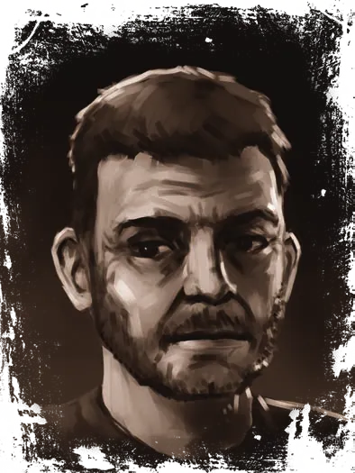

### Терри Дуглас



**Возраст:** 45 лет. **Род занятий:** океанограф.

```stat
СИЛ 65    ВЫН 60    ТЕЛ 70    ЛВК 60    ИНТ 70
НАР 50    МОЩ 60    ОБР 80    Рассудок 60   ПЗ 13
БкУ: +1d4    Комплекция: 1   Скорость: 6   ПМ: 12   Удача: 55

Бой
Ближний бой (драка)   25% (12/5), урон 1d3 + БкУ
Уклонение             32% (16/6)

Навыки
Внимание 45% (22/9)
Естествознание 70% (35/14)
Красноречие 35% (17/7)
Лазание 40% (20/8)
Метание 20% (10/4)
Наука (биология) 70% (35/14)
Наука (ботаника) 60% (30/12)
Наука (химия) 60% (30/12)
Первая помощь 30% (15/6)
Плавание 50% (25/10)
Подводное плавание 40% (20/8)
Прыжки 20% (10/4)
Психология 15% (7/3)
Работа в библиотеке 30% (15/6)
Работа с компьютером 15% (7/3)
Скрытность 40% (20/8)
Слух 25% (12/5)
Средства 35% (17/7)
Стрельба (винтовка/дробовик) 25% (12/5)
Стрельба (пистолет) 20% (10/4)
Язык (английский) 80% (40/16)
```

**Бонус:** распределите 30 пунктов между любыми навыками на выбор игрока.

#### Предыстория

Проект «Нергал» — это экспериментальная буровая установка, обустроенная для пробития земной коры и созданная на основании бывшей нефтяной платформы в Северном море. Проект включает сбор и очистку нового источника энергии, названного «ролотный газ» или просто «ролот», который открыл доктор Саймон Ройлотт — руководитель проекта. Проект привлёк большое внимание. Теперь он получает огромное государственное финансирование и поддержку от Джеральда Уайнстепа, министра по вопросам бизнеса, энергетики и промышленной стратегии. Доктор Ройлотт установил ядерный реактор, чтобы запитать буровую установку и позволить ей пробиться на ранее неслыханную глубину. Исполнительный директор проекта — Пирс Голдман, гражданский чиновник, который руководит логистикой и решает все вопросы, не касающиеся науки. Вы — команда экспертов, которую послали провести инспекцию платформы «Дыра дьявола» и определить, оправдывает ли она затраты, безопасна ли она и насколько вероятно, что проект будет успешным. На основании вашего доклада проект либо закроют, либо дадут добро на дальнейшее финансирование. Вам должны беспрекословно предоставить доступ ко всем частям платформы.

- **Описание:** Крепкий, с широкой грудью, короткой стрижкой и круглым лицом.
- **Черты:** Любит рисковать, жизнерадостный.
- **Идеология/убеждения:** Человечество плохо сказывается на планете.

#### Проверяющие

- Вы, океанограф
- Джессика Андерсон, учёная (геохимик) и руководительница команды
- Филипп Суонн, учёный (физик-ядерщик)
- Виктор Манн, системный инженер и инженер-технолог
- Триша Хики, консультант по персоналу
- Клэрис Уильямс, депутат парламента

*Прим. перев.: лист дан по официальному русскому изданию. В оригинале опечатки долей: «Brawl 25% (12/15)» (верно 12/5) и «Library Use 30% (16/6)» (верно 15/6).*
