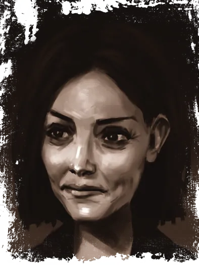

### Триша Хики



**Возраст:** 42 года. **Род занятий:** консультантка по персоналу.

```stat
СИЛ 65    ВЫН 70    ТЕЛ 55    ЛВК 60    ИНТ 80
НАР 65    МОЩ 50    ОБР 70    Рассудок 50   ПЗ 12
БкУ: 0    Комплекция: 0   Скорость: 7   ПМ: 10   Удача: 60

Бой
Ближний бой (драка)   45% (22/9), урон 1d3
Уклонение             30% (15/6)

Навыки
Бухгалтерское дело 25% (12/5)
Внимание 60% (30/12)
Запугивание 50% (25/10)
Красноречие 40% (20/8)
Лазание 30% (15/6)
Метание 30% (15/6)
Обаяние 50% (25/10)
Первая помощь 50% (25/10)
Плавание 30% (15/6)
Прыжки 30% (15/6)
Психология 60% (30/12)
Работа в библиотеке 40% (20/8)
Скрытность 50% (25/10)
Слух 50% (25/10)
Средства 45% (22/9)
Стрельба (винтовка/дробовик) 25% (12/5)
Стрельба (пистолет) 20% (10/4)
Юриспруденция 35% (17/7)
Язык (английский) 70% (35/14)
Язык (голландский) 20% (10/4)
```

**Бонус:** распределите 30 пунктов между любыми навыками на выбор игрока.

#### Предыстория

Проект «Нергал» — это экспериментальная буровая установка, обустроенная для пробития земной коры и созданная на основании бывшей нефтяной платформы в Северном море. Проект включает сбор и очистку нового источника энергии, названного «ролотный газ» или просто «ролот», который открыл доктор Саймон Ройлотт — руководитель проекта. Проект привлёк большое внимание. Теперь он получает огромное государственное финансирование и поддержку от Джеральда Уайнстепа, министра по вопросам бизнеса, энергетики и промышленной стратегии. Доктор Ройлотт установил ядерный реактор, чтобы запитать буровую установку и позволить ей пробиться на ранее неслыханную глубину. Исполнительный директор проекта — Пирс Голдман, гражданский чиновник, который руководит логистикой и решает все вопросы, не касающиеся науки. Вы — команда экспертов, которую послали провести инспекцию платформы «Дыра дьявола» и определить, оправдывает ли она затраты, безопасна ли она и насколько вероятно, что проект будет успешным. На основании вашего доклада проект либо закроют, либо дадут добро на дальнейшее финансирование. Вам должны беспрекословно предоставить доступ ко всем частям платформы.

- **Описание:** Среднего роста, в модном деловом костюме, с тёмными волосами, стриженными в каре.
- **Черты:** Властная, узкие взгляды.
- **Идеология/убеждения:** У всех есть секреты, которые можно использовать, чтобы добиться желаемого.

#### Проверяющие

- Вы, консультант по персоналу
- Джессика Андерсон, учёная (геохимик) и руководительница команды
- Филипп Суонн, учёный (физик-ядерщик)
- Терри Дуглас, океанограф
- Виктор Манн, системный инженер и инженер-технолог
- Клэрис Уильямс, депутат парламента

*Прим. перев.: лист дан по официальному русскому изданию («Кошмары цифровой эпохи»).*
