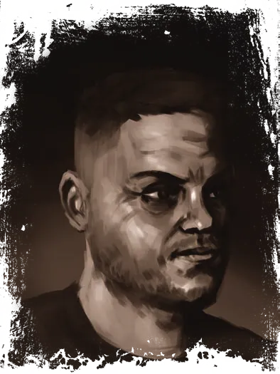

### Виктор Манн



**Возраст:** 49 лет. **Род занятий:** системный инженер и инженер-технолог.

```stat
СИЛ 80    ВЫН 70    ТЕЛ 65    ЛВК 50    ИНТ 70
НАР 55    МОЩ 55    ОБР 85    Рассудок 55   ПЗ 13
БкУ: +1d4    Комплекция: 1   Скорость: 6   ПМ: 11   Удача: 55

Бой
Ближний бой (драка)   55% (27/11), урон 1d3 + БкУ
Уклонение             35% (17/7)

Навыки
Внимание 25% (12/5)
Запугивание 15% (7/3)
Лазание 20% (10/4)
Метание 20% (10/4)
Механика 75% (37/15)
Наука (инженерия) 70% (35/14)
Наука (математика) 55% (27/11)
Обаяние 15% (7/3)
Первая помощь 30% (15/6)
Плавание 30% (15/6)
Прыжки 20% (10/4)
Психология 10% (5/2)
Работа в библиотеке 40% (20/8)
Скрытность 20% (10/4)
Слух 20% (10/4)
Средства 40% (20/8)
Стрельба (винтовка/дробовик) 45% (22/9)
Стрельба (пистолет) 45% (22/9)
Убеждение 25% (12/5)
Управление тяжёлыми машинами 40% (20/8)
Электрика 65% (32/13)
Электроника 40% (20/8)
Юриспруденция 30% (15/6)
Язык (английский) 85% (42/17)
```

**Бонус:** распределите 30 пунктов между любыми навыками на выбор игрока.

#### Предыстория

Проект «Нергал» — это экспериментальная буровая установка, обустроенная для пробития земной коры и созданная на основании бывшей нефтяной платформы в Северном море. Проект включает сбор и очистку нового источника энергии, названного «ролотный газ» или просто «ролот», который открыл доктор Саймон Ройлотт — руководитель проекта. Проект привлёк большое внимание. Теперь он получает огромное государственное финансирование и поддержку от Джеральда Уайнстепа, министра по вопросам бизнеса, энергетики и промышленной стратегии. Доктор Ройлотт установил ядерный реактор, чтобы запитать буровую установку и позволить ей пробиться на ранее неслыханную глубину. Исполнительный директор проекта — Пирс Голдман, гражданский чиновник, который руководит логистикой и решает все вопросы, не касающиеся науки. Вы — команда экспертов, которую послали провести инспекцию платформы «Дыра дьявола» и определить, оправдывает ли она затраты, безопасна ли она и насколько вероятно, что проект будет успешным. На основании вашего доклада проект либо закроют, либо дадут добро на дальнейшее финансирование. Вам должны беспрекословно предоставить доступ ко всем частям платформы.

- **Описание:** Низкий и слегка полноватый, с широкими плечами и стрижкой ёжиком.
- **Черты:** Лёгкий в общении, любит пошутить.
- **Идеология/убеждения:** Ненавидит несправедливость и задир.

#### Проверяющие

- Вы, системный инженер и инженер-технолог
- Джессика Андерсон, учёная (геохимик) и руководительница команды
- Филипп Суонн, учёный (физик-ядерщик)
- Терри Дуглас, океанограф
- Триша Хики, консультант по персоналу
- Клэрис Уильямс, депутат парламента

*Прим. перев.: лист дан по официальному русскому изданию («Кошмары цифровой эпохи»).*
