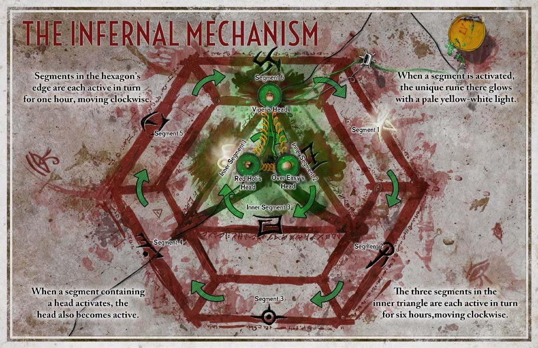

содержатся на складе как пленницы. Шарпи (она же Ребека Эстрада), девушка из банды, вместе как минимум с двумя парнями из банды постоянно сторожит медсестёр.

### Инфернальный механизм

Склад — тревожное место. По стенам повторяется нарисованный красной краской знак разных размеров, похожий на стилизованный глаз (см. «Око Ньярлатхотепа» рядом). А на полу нарисован большой шестиугольник, внутри которого нарисован треугольник. И стороны шестиугольника, и треугольник разделены на сегменты, и в каждом нарисован чёрной краской знак. Голова Вайпера стоит в точке «12 часов» шестиугольника, а головы Ред Хота и Овер Изи — каждая в своём сегменте внутреннего треугольника (см. схему «Инфернальный механизм» рядом; вариант схемы для игроков — «Материал: голос 1» — на с. 193). Раздатки для игроков с Оком Ньярлатхотепа и Инфернальным механизмом собраны в разделе «Раздатки» в конце книги.

С помощью тайных знаний, полученных от оживлённой головы брата (на самом деле эти знания исходят от Ньярлатхотепа, говорящего через голову Вайпера), доктор Лопес магически наделил силой причудливые знаки на полу — когда знаки активны, они горят адским светом. Почти как на часах, сегменты по краю шестиугольника по очереди светятся, когда активны; так же светятся и знаки внутри треугольника. Таким образом, в каждый момент активны один знак шестиугольника и один знак треугольника.

Как на часах, каждый сегмент по очереди становится активным. «Стрелка» шестиугольника сдвигается раз в час, сегменты треугольника — раз в 6 часов. Когда активен сегмент шестиугольника с головой Вайпера (вверху шестиугольника), голова может делиться великой мудростью и предсказывать будущее и делает это разное время — от нескольких минут до часа. Так что раз в 6 часов голова Вайпера становится активной.

Когда активным становится сегмент с головой Ред Хота, его глаза открываются и пылают огнём. На этот случай доктор Лопес сказал банде, что Ред Хоту нужно принести в жертву часть человеческого тела — например, отрезать палец или ухо или вырвать зуб. Часть тела не обязательно должна принадлежать члену банды (часто используют жертв против их воли), но эта «малая» жертва теперь стала частью обряда посвящения: новички должны отдать что-то от себя, чтобы их приняли в банду. Чем важнее часть тела (то есть чем больше жертва), тем дольше глаза Ред Хота остаются открытыми. Однажды, когда банда отрубила жертве кисть, глаза Ред Хота оставались открытыми целых четыре часа.

Когда активен сегмент с головой Овер Изи, его глаза открываются и пылают изумрудным светом. Овер Изи тоже нужна жертва — в его случае это должна быть смерть. К счастью, смерть не обязательно человеческая: подойдёт любое мелкое животное (чаще всего голубь, кошка или собака). Банда

**Инфернальный механизм** (пояснения на схеме):

- Сегменты по краю шестиугольника активны по очереди, по одному часу каждый, по часовой стрелке.
- Когда сегмент активируется, его особая руна светится бледным жёлто-белым светом.
- Когда активируется сегмент с головой, голова тоже становится активной.
- Три сегмента внутреннего треугольника активны по очереди, по шесть часов каждый, по часовой стрелке.
- Подписи на схеме: Сегменты 1–6 (сегмент 6 вверху — голова Вайпера), Внутренние сегменты 1–3; голова Ред Хота, голова Овер Изи.
