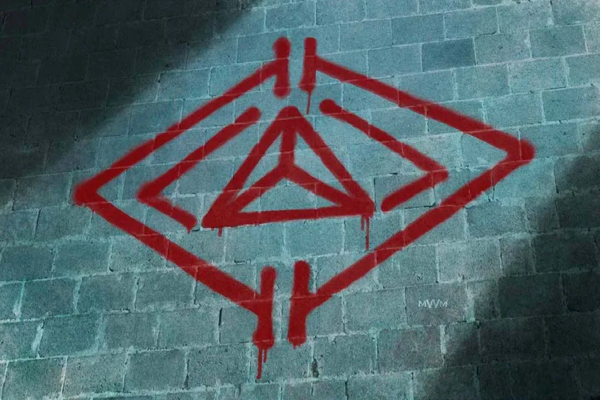

лишь однажды принесла Овер Изи в жертву человека, и тогда его глаза оставались открытыми 7 часов. Когда активен пустой третий сегмент треугольника, банде не нужно приносить жертву.

Доктор Лопес предупредил банду: если не принести требуемые жертвы головам Ред Хота и Овер Изи, на банду обрушится великое бедствие и она потеряет обретённую силу. Поэтому члены банды делают, что велено, чтобы не навлечь на себя гнев доктора Лопеса и голов.

### Сила голов

Никто не знает, что все три оживлённые головы на самом деле — проводники Ньярлатхотепа, и каждую «питает» Инфернальный механизм. Голова Вайпера — рупор Внешнего бога: когда она активна, то сообщает находящимся на складе особое знание о будущем. По сути, Вайпер может предсказывать события, которые случатся через шесть часов, и банда готова ко всему. Поэтому банда готова и к полицейским облавам, и к нападениям соперников и может обратить их себе на пользу. Так банда и опережает на шаг все попытки её арестовать или уничтожить.

Учтите, что если принести Ред Хоту или Овер Изи большие жертвы, их головы остаются активными дольше. Если обе головы станут активны одновременно, их совокупная магическая энергия призовёт бродягу между измерениями. Чудовище подчиняется воле Вайпера (см. «Бродяга в банде», с. 172). Если Ред Хот и Овер Изи активны в то же время, когда активируется голова Вайпера, призывается и связывается с Вайпером другое существо Мифов — какое чудовище явится, решает Хранитель (при желании его можно определить случайно).

Например, если Ред Хоту принесли в жертву человеческую ногу или голову, его голова остаётся активной 7 часов — так что голова Ред Хота всё ещё активна, когда Инфернальный механизм сдвигается дальше и активирует сегмент с головой Овер Изи. Поскольку активны обе головы, появляется бродяга между измерениями. Если активны обе головы и вдобавок голове Вайпера принесена достаточно сильная жертва, пока она активна, призывается другое, более могущественное чудовище (см. «Влюблённая пара», с. 173, и «Случайный призыв чудовища», с. 173).

Вайпер сказал банде: если они сумеют принести достаточно большие жертвы, чтобы головы Ред Хота и Овер Изи пробудились одновременно, банда получит дар (бродягу между измерениями). Пока банде ещё не удавалось сделать головы активными одновременно, но это лишь вопрос времени.

Что всё это значит: в какой-то момент сценария ЮВ14 «вербует» в свои ряды бродягу между измерениями, а чуть позже, если Хранитель пожелает, банда может «завербовать» ещё одно, куда более опасное чудовище. Вероятнее всего, бродягу будут посылать убивать или похищать членов соперничающих банд или даже полицейских из группы по борьбе с бандами; это ещё больше сбивает с толку и выводит из равновесия соперников ЮВ14 и обеспечивает банде дальнейшее господство. Пока сыщиков водят за нос, их враг только крепнет.

*Око Ньярлатхотепа*
