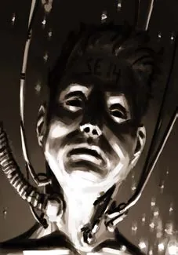

- …родственные узы подстегнули игроков и привели их к кульминации сценария. Как вариант, если Хранитель хочет напрямую вовлечь игроков, двое из готовых сыщиков описаны как пара — их тоже можно сделать целью похищения.
- У каждого готового сыщика есть одно или несколько видов оружия. По ходу сценария сыщики, скорее всего, захотят раздобыть оружие помощнее — например, полуавтоматическое. Такое оружие можно без особой возни достать через связи в банде. Хранителю стоит избегать лишнего учёта и сосредоточиться на драме, используя такие просьбы, чтобы разыграть отношения персонажей игроков с другими членами банды («Пушку дам, но с тебя услуга»).

# Действующие лица

В сценарии пять основных групп персонажей Хранителя:

- ЮВ14 — банда Вайпера;
- ЮВ13 — банда Молотило, соперница ЮВ14;
- «Рейес Кальехерос» — соперничающая банда;
- полиция;
- (по желанию) «Диаблос Чикос» — соперничающая банда.

Ниже дан обзор каждой группы с главными действующими лицами и примерами персонажей Хранителя; характеристики всех персонажей — начиная со с. 175.

## ЮВ14 (она же «Юго-Восток Четырнадцать»)

Поначалу отколовшаяся часть ЮВ13, теперь ЮВ14 — самостоятельная банда, которой руководит оживлённая голова Вайпера (Диего Лопеса), а ухаживает за ней его брат, доктор Хуан Лопес. Сейчас в банде 37 членов (80% мужчин, 20% женщин), но каждый месяц приходят новые — во многом потому, что нужен постоянный запас новичков, готовых в ходе посвящения пожертвовать оживлённым головам части своего тела. Слава о делах и растущей силе банды разносится, и желающие вступить (некоторым всего по десять лет) выстраиваются в очередь.

Не считая голов Ред Хота и Овер Изи, у Вайпера 7 лейтенантов, которые держат банду под контролем и поддерживают в ней порядок. Каждый лейтенант беззаветно предан ЮВ14, Вайперу и — за его искусство спасать жизни и родство с Вайпером — доктору Хуану Лопесу. Тех, кто идёт против банды, в том числе оступившихся младших членов, наказывает один из лейтенантов; обычно провинившийся должен пожертвовать головам важную часть тела (например, глаз или кисть) в знак покаяния.

**Лейтенанты ЮВ14 (7)**

- Голди
- Стикс
- Рипер
- Литл Эскобар
- Ред Ай
- Вулф
- Лизард

Цвет банды — зелёный (часто это зелёно-чёрный платок, повязанный на руку или продетый в шлёвку ремня), и у всех посвящённых членов банды есть татуировка — летучая мышь, летящая над одинокой звездой или сидящая на ней, — а также надпись «ЮВ14» (обычно крупными буквами) на груди, спине, руках или голове.

### Вайпер (Диего Лопес), *28 лет, глава банды*

Хотя все члены банды считают Вайпера живым (пусть от него и осталась одна голова), оживлённая голова на самом деле не более чем рупор Ньярлатхотепа. Вайпер «просыпается», когда Инфернальный механизм активирует сегмент, в котором он находится (раз в 6 часов), и голова может давать советы о грядущих событиях, а также делиться дивной бесконечной мудростью (за каждые 5 минут, что голова говорит об истинной природе реальности, слушатель получает 1 пункт Мифов Ктулху и теряет 1 пункт Рассудка). Голова Вайпера активна 6d10 минут (а может и дольше — на усмотрение Хранителя). Подробнее — в профиле Вайпера (с. 175).

*Прим. перев.: здесь механизм назван «Infernal Machine» — это тот же Инфернальный механизм.*

Голова способна видеть будущее и давать банде указания, как избежать надвигающихся угроз и воспользоваться открывающимися возможностями. Единственный способ свести на нет способность Вайпера — придумать план и сразу же его выполнить (до того, как голова снова станет активной); если составить план и ждать утра, чтобы его выполнить, Вайпер наверняка успеет предупредить банду.

Вайпер с помощью Шарпи (см. ниже) звонит сыщикам по одноразовому телефону, чтобы сбивать их с толку и изводить: делает их пушечным мясом, когда являются соперничающие банды, вообще мешает им и подставляет в щекотливых положениях, из-за которых их верность может оказаться под сомнением. Подробнее — «Голос в трубке», с. 169.
