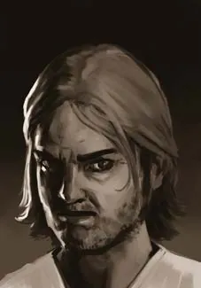

## ЮВ13 (она же «Юго-Восток Тринадцать»)

ЮВ13 контролирует район к северу от Плезант-Гроува. Теперь, когда ЮВ14 Вайпера стала независимой, ЮВ13 хочет вернуть свою прежнюю территорию — и вдобавок горит желанием убить Вайпера и уничтожить банду-выскочку за предательство.

Сейчас в ЮВ13 60 активных членов (70% мужчин, 30% женщин) — от 10–11-летних до тех, кому чуть за сорок; большинству от 16 до 25 лет. Настоящий главарь ЮВ13 — Синнер (Хесус Родригес), который дожидается казни в камере смертников тюрьмы Аллан-Б.-Полунски в Ливингстоне, штат Техас. Из-за строгих условий заключения Синнера повседневное управление ЮВ13 перешло к Молотило (он же Сантьяго Гарсия).

*Прим. перев.: имя Синнера напечатано «Jesùs» (вместо «Jesús»).*

ЮВ13 славится жестокостью: когда-то банда завоевала свою территорию неразборчивыми зверствами и убийствами. С тех пор как ЮВ14 Вайпера откололась и объявила о независимости, некоторые члены ЮВ13 начали сомневаться в главенстве Молотило: мол, Синнер вообще не допустил бы такого. Как ни старался Молотило уничтожить выскочек, ЮВ14 оставалась на шаг впереди и срывала все попытки с ней покончить. Даже нападение на главаря ЮВ14 Вайпера, после которого его, казалось, бросили умирать, похоже, обернулось против ЮВ13. На улицах говорят, что Вайпер жив и прочно держит ЮВ14 в руках, а хуже всего — с тех пор банда стала ещё сильнее.

Цвет банды — синий, а её знак — одинокая звезда (часто с буквами «ЮВ13»).

Готовые сыщики — члены ЮВ13, подчинённые Молотило. Поскольку Молотило считают слабым, у сыщиков (если они добьются успеха) есть хорошие шансы сместить его и взять ЮВ13 под свой контроль. Хранителю стоит указать на это игрокам как на дополнительный стимул действовать смело и не упускать свой шанс.

### Молотило, *34 года, главарь ЮВ13*

Положение Молотило незавидное: из-за ЮВ14 он потерял территорию и так и не смог приструнить отколовшуюся банду. Каждый день, пока Вайпер и ЮВ14 остаются безнаказанными, его положение слабеет; Молотило зол и в отчаянии. Хуже того, полиция пытается взяться за бандитскую преступность, и в его районах и районах ЮВ14 стало больше полицейских.

Молотило пришло в голову, что кто-то в ЮВ13 — «крот», который работает на ЮВ14 и держит её в курсе планов ЮВ13. Поэтому он лично отбирает команду (сыщиков) и приказывает им найти и убить Вайпера, надеясь, что так ЮВ14 придёт конец. Он выбрал для этого самых надёжных товарищей, а сам тем временем займётся поисками предполагаемого «крота» в своих рядах. Поэтому большую часть сценария Молотило остаётся за кадром.

- **Описание:** выше среднего роста, полный, но крепко сбитый, волосы до плеч. На лице татуировок нет, но тело покрыто шрамами и бандитскими наколками.
- **Черты:** отчасти мегаломан; проницателен и, прежде чем взяться за дело, тщательно взвешивает все возможности.
- **Зацепки для отыгрыша:** посылает сыщиков выследить Вайпера; может выделить подкрепление (если нужно) и персонажей на замену выбывшим.

### Гордо, *23 года, типичный член ЮВ13*

Больше всего Гордо любит вечеринки, а когда не гуляет, сидит в старом кресле перед притоном ЮВ13, отпускает шуточки и делится мудростью с членами банды. Гордо — кладезь знаний, он любит читать (что не очень свойственно его братьям по банде).

Молотило, уверенный, что в ЮВ13 есть «крот», тайно поручил Гордо вычислить предателя. Сыщикам может позвонить Гордо и попросить о встрече, чтобы расспросить их и убедиться в их верности. Если верность кого-то из сыщиков банде покажется сомнительной, Гордо приходит к нему домой или пытается застать его одного, чтобы «поговорить» с глазу на глаз. Если Гордо укажет на одного или нескольких сыщиков, за ними будет охотиться вся ЮВ13 — тогда сыщикам придётся либо представить ясные доказательства своей невиновности (то есть доказать, что Вайпер — живая голова, способная предсказывать будущее), либо подставить другого (невиновного) члена банды, чтобы тот ответил за всё.

- **Описание:** крупный, грузный, коротко стриженный, в бейсболке и огромной, как палатка, футболке.
- **Черты:** хитёр и много знает, упорно добивается правды.
- **Зацепки для отыгрыша:** проверяет верность сыщиков банде и может следить за ними через свою сеть детей-«шпионов». Может (ошибочно) обвинить одного или нескольких сыщиков в том, что они предатели в ЮВ13.
