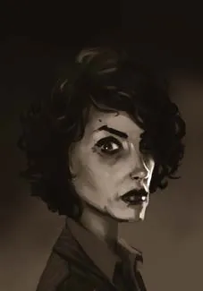
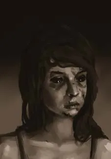

Недавний рост бандитской преступности и общий подъём насилия на улицах Плезант-Гроува вызывают тревогу. При усилившемся внимании прессы полиция получила приказ взяться за положение (да и сама хочет, чтобы видели, что она этим занимается). Отсюда и создание группы по борьбе с бандами под руководством сержанта Эмилиано Гарсии.

Подразделения следят за бандитской преступностью в районе и заметили, сколько территории захватила отколовшаяся банда ЮВ14. Увы, каждый шаг против ЮВ14 заканчивался провалом, и ни одного члена ЮВ14 так и не арестовали. Подозреваемых из соседних банд полиция задерживает без особого труда, но ЮВ14 — словно призраки: их присутствие ощущается, но их самих никто не видит. Поэтому заместитель начальника полиции Смит опасается, что в полиции завёлся «крот», который снабжает ЮВ14 сведениями и предупреждает о готовящихся облавах и рейдах. Он вызвал службу собственной безопасности, чтобы та присмотрелась к происходящему.

Расследование службы собственной безопасности возглавляет Сьюзан Кроссли, и она, скорее всего, будет пристально следить за группой по борьбе с бандами (особенно если её членов играют игроки). Расспросы Кроссли уже вызывают беспокойство в отделе, и, хотя ничего определённого пока не всплыло, обстановка, похоже, будет только накаляться.

### Сьюзан Кроссли, *42 года, служба собственной безопасности*

Кроссли может при необходимости вызвать подкрепление, но пока ведёт расследование в одиночку — ищет предполагаемого «крота» в юго-восточном отделе. Доказательств у неё нет, но она начинает присматриваться к недавно созданной группе по борьбе с бандами: чутьё подсказывает ей, что эти опытные полицейские, возможно, как-то «берут». Своей обвиняющей манерой она уже настроила против себя многих патрульных и, скорее всего, то же будет и с теми, кто работает в штатском или под прикрытием.

Кроссли — тёмная лошадка, задуманная, чтобы донимать сыщиков-полицейских; если же сыщики — бандиты, её роль, скорее всего, почти незаметна.

- **Описание:** среднего роста, властного телосложения, короткие кудрявые волосы; хорошо одета — в элегантный костюм.
- **Черты:** любопытна и проницательна; за маской безмятежности — агрессивна и мстительна.
- **Зацепки для отыгрыша:** может попроситься в поездку вместе с сыщиками-полицейскими, вызвать их на допрос и покопаться в их прошлом. Возможно, следит за допросами в участке через видеонаблюдение, а потом ставит под сомнение методы и тактику сыщиков.

### Сэмми Волчек, *38 лет, продажный полицейский*

Хранитель может ввести продажного детектива, чтобы поставить перед игроками, которые играют полицейскую группу, нравственные дилеммы. Сэмми Волчек может быть членом группы по борьбе с бандами или просто вести дело в Плезант-Гроуве (убийство). Возможно, кто-то из сыщиков видит то, чего не должен был видеть (то есть нестандартные полицейские методы или прямую взятку), и Волчек пытается его подкупить, а если тот не соглашается — шантажирует.

С тем же успехом Волчек может снабдить сыщиков-бандитов сведениями, которые им нелегко было бы добыть, — например, о пропавших медсёстрах и о том, что заместитель начальника полиции подозревает «крота» в полиции. Волчек, считая, что Сьюзан Кроссли вышла на его след, пытается укрепить своё положение в полиции, подставив сыщиков в преступлении, которое расследует. Во всяком случае, Волчек может здорово осложнить сыщикам жизнь.

- **Описание:** среднего роста, телосложение уже не то, что прежде, бритая голова.
- **Черты:** жаден, приспособленец.
- **Зацепки для отыгрыша:** источник сведений — или неприятностей.

## Медсёстры

Обе похищенные медсестры работают в больнице Паркленд вместе с доктором Лопесом; четыре недели назад, в свободное от работы время, их похитили члены ЮВ14. Семьи подали заявления о пропаже, но пока полиции не удалось найти чёрный «Шевроле Тахо» (номер BK7 H679), который видели у домов обеих медсестёр в ночь похищения; по ходу сценария внедорожник может найтись — сожжённый на каком-нибудь пустыре в Плезант-Гроуве (см. «Ключевые события», с. 169).

### Дженетт Уильямс и Мия Торрес

Под бдительным присмотром Шарпи (см. с. 157) и пары членов банды медсёстры должны доливать líquido verde в баки с головами и следить за их жизненными показателями по украденному больничному оборудованию. Обе
