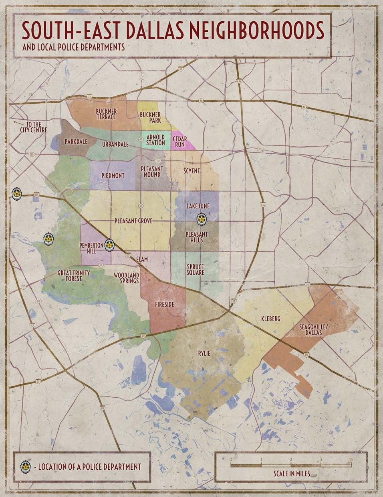

**Юго-восточные районы Далласа и местные отделения полиции** (подписи на карте):

| На карте | Перевод |
|---|---|
| To the City Centre | К центру города |
| Buckner Terrace · Buckner Park · Parkdale · Urbandale · Arnold Station · Cedar Run | Бакнер-Террас · Бакнер-Парк · Паркдейл · Урбандейл · Арнолд-Стейшн · Сидар-Ран |
| Piedmont · Pleasant Mound · Scyene · Lake June | Пидмонт · Плезант-Маунд · Сайин · Лейк-Джун |
| Pleasant Grove · Pleasant Hills · Pemberton Hill · Elam · Spruce Square | Плезант-Гроув · Плезант-Хиллз · Пембертон-Хилл · Элам · Спрус-Сквер |
| Great Trinity Forest · Woodland Springs · Fireside | Грейт-Тринити-Форест · Вудленд-Спрингс · Файрсайд |
| Kleberg · Seagoville/Dallas · Rylie | Клеберг · Сиговилл (Даллас) · Райли |
| ⊛ — Location of a Police Department | ⊛ — отделение полиции |
| Scale in miles (0–4) | Масштаб в милях (0–4; 1 миля ≈ 1,6 км) |
