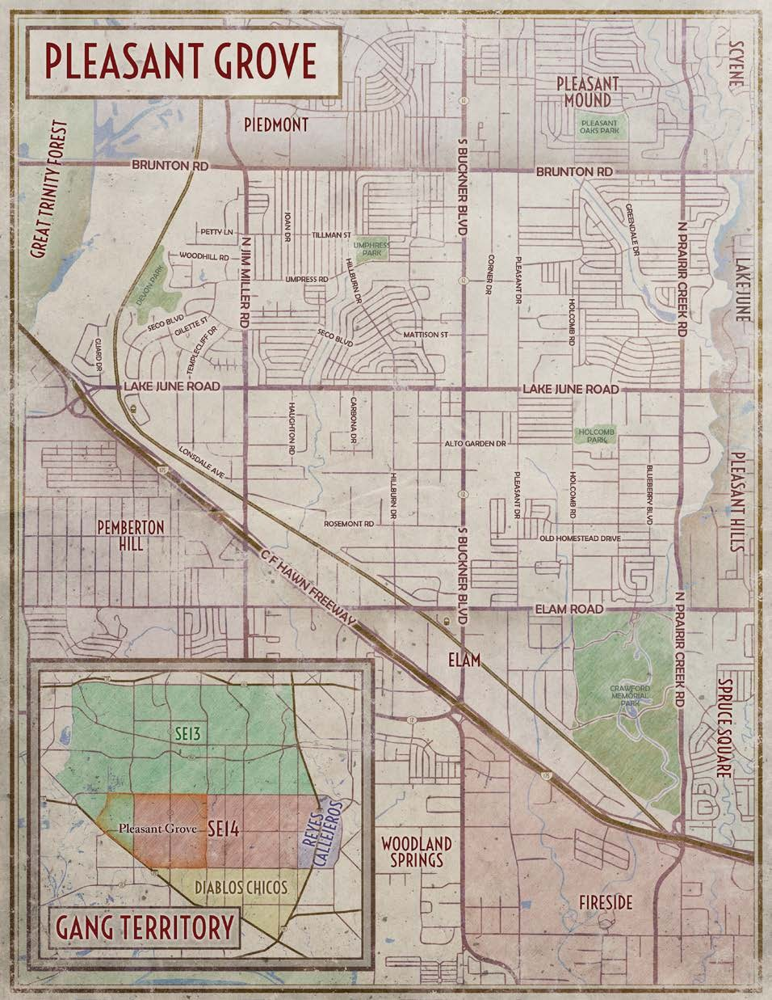

**Плезант-Гроув** (подписи на карте):

| На карте | Перевод |
|---|---|
| Piedmont · Pleasant Mound · Scyene · Lake June · Pleasant Hills · Pemberton Hill · Elam · Spruce Square · Woodland Springs · Fireside · Great Trinity Forest | Пидмонт · Плезант-Маунд · Сайин · Лейк-Джун · Плезант-Хиллз · Пембертон-Хилл · Элам · Спрус-Сквер · Вудленд-Спрингс · Файрсайд · Грейт-Тринити-Форест |
| Brunton Rd · N Jim Miller Rd · S Buckner Blvd · N Prairir Creek Rd | Брунтон-роуд · Норт-Джим-Миллер-роуд · Саут-Бакнер-бульвар · Норт-Прери-Крик-роуд |
| Lake June Road · Elam Road · C F Hawn Freeway | Лейк-Джун-роуд · Элам-роуд · шоссе Си-Эф-Хоун |
| Petty Ln · Woodhill Rd · Joan Dr · Tillman St · Umpress Rd · Hillburn Dr · Corner Dr · Pleasant Dr · Greendale Dr · Holcomb Rd | Петти-лейн · Вудхилл-роуд · Джоан-драйв · Тиллман-стрит · Амфресс-роуд · Хиллберн-драйв · Корнер-драйв · Плезант-драйв · Гриндейл-драйв · Холкомб-роуд |
| Seco Blvd · Gilette St · Templecliff Dr · Guard Dr · Mattison St · Haughton Rd · Carbona Dr · Alto Garden Dr · Lonsdale Ave · Rosemont Rd · Blueberry Blvd · Old Homestead Drive | Секо-бульвар · Жилетт-стрит · Темплклифф-драйв · Гард-драйв · Маттисон-стрит · Хоутон-роуд · Карбона-драйв · Альто-Гарден-драйв · Лонсдейл-авеню · Роузмонт-роуд · Блуберри-бульвар · Олд-Хомстед-драйв |
| Pleasant Oaks Park · Umphress Park · Devon Park · Holcomb Park · Crawford Memorial Park | парк Плезант-Оукс · парк Амфресс · парк Девон · парк Холкомб · Мемориальный парк Кроуфорда |

**Врезка «Территории банд»:** ЮВ13 — к северу от Плезант-Гроува; ЮВ14 — Плезант-Гроув; «Рейес Кальехерос» — к востоку; «Диаблос Чикос» — на юге Плезант-Гроува.

*Прим. перев.: на карте — «Brunton Rd» (в тексте — Bruton Road) и «N Prairir Creek Rd» (Prairie Creek). Подпись на полях этой страницы в оригинале — «South-East Dallas Neighborhoods Map», хотя здесь карта Плезант-Гроува.*
