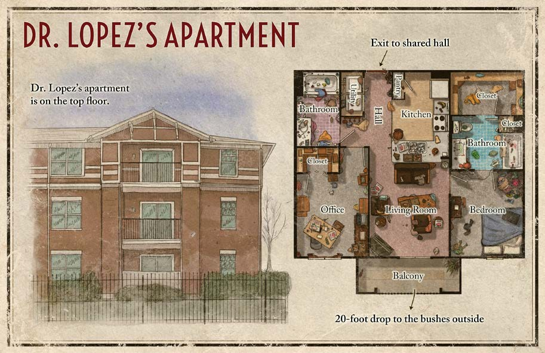

больницы, но чтобы туда попасть, нужна уловка или взлом в нерабочее время (проверки навыков — по обстоятельствам); полиции это, разумеется, куда проще. Сообразительный сыщик может обыскать шкафчик доктора Лопеса в комнате персонала приёмного отделения (возможно, понадобятся Маскировка или Искусство/ремесло (актёрская игра) и Скрытность) или применить Обаяние либо Запугивание к медсестре или другому работнику больницы. Если адрес удастся добыть, он приведёт сыщиков в квартиру доктора Лопеса в районе Саут-Даллас / Фэр-Парк.

Сыщики могут также узнать, что месяц назад о пропаже двух медсестёр (Мии Торрес и Дженетт Уильямс) заявили в полицию; обе медсестры работали в приёмном отделении вместе с доктором Лопесом (см. «Медсёстры», с. 160).

Сыщики-полицейские могут раскопать сведения о пропавшем медицинском оборудовании (вряд ли сыщикам-бандитам придёт в голову о таком спросить, но медсестра может упомянуть об этом мимоходом). Недавняя проверка выявила, что из приёмного отделения пропало следующее (всё это взял доктор Лопес):

- быстропоточный подогреватель жидкостей H-1200 (для быстрого вливания тёплых растворов);
- портативный дефибриллятор;
- монитор жизненных показателей Connex;
- инфузионная система;
- насосный модуль Alaris (для подачи жидкостей);
- разные медицинские принадлежности (перчатки, бинты, наборы для наложения швов и т. п.);
- длинный список лекарств, в том числе:
    - ативан (при тревожных расстройствах);
    - азитромицин (при бактериальных инфекциях);
    - катапрес (расслабляет кровеносные сосуды);
    - дофамин (при шоке и травме);
    - морфин (обезболивающее);
    - метилфенидат (стимулятор центральной нервной системы).

Учтите, что любые «сцены», устроенные сыщиками-бандитами в больнице или на её территории, могут привести к вызову охраны, а в зависимости от обстоятельств — и к приезду полиции.

## Квартира доктора Лопеса

У доктора Лопеса квартира с двумя спальнями на верхнем этаже жилого комплекса из двадцати квартир выше среднего класса на Саут-бульваре в районе Саут-Даллас / Фэр-Парк, чуть больше чем в 16 км от Плезант-Гроува. Если Вайпер его предупредил, доктора Лопеса там не будет. В любое время дня и ночи шторы задёрнуты.

В комнатах беспорядок: повсюду разбросана одежда, на всех поверхностях — недоеденные полуфабрикаты из микроволновки и коробки из-под пиццы, тут и там валяются разные медицинские принадлежности. Вторая спальня служит кабинетом и кладовкой; при обыске комнаты нужна проверка Внимания, чтобы найти ноутбук, спрятанный под большой коробкой из-под пиццы.

**Квартира доктора Лопеса** (подписи на плане):

- Квартира доктора Лопеса — на верхнем этаже.
- Выход в общий коридор.
- Ванная, туалет, кладовка, прихожая, кухня, шкаф, ванная.
- Шкаф, кабинет, гостиная, спальня.
- Балкон — внизу, в 6 м, кусты.
