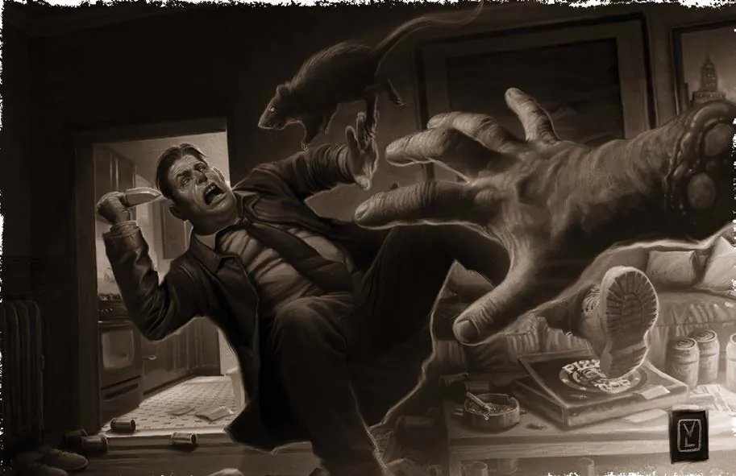

Пароль компьютера доктора Лопеса — «Viper», но его можно взломать успешной проверкой Работы с компьютером. В файлах компьютера много снимков животных — крыс, мышей, кроликов и кошек, многие из которых, похоже, мертвы. Фотографии сделаны за несколько последних лет. Успешная проверка Работы в библиотеке находит на жёстком диске видеозапись полугодовой давности; если её включить, видно, как доктор Лопес ставит опыт над, судя по всему, мёртвой (во всяком случае, неподвижной) крысой. Слышно, как Лопес говорит о чём-то под названием «líquido verde» и о том, что, по его мнению, он наконец довёл до совершенства «своё творение». Он отрубает крысе голову большим мясницким тесаком, затем кладёт её голову на пластиковую разделочную доску, которую берёт на кухне. Он тычет в голову крысы, говорит, что она явно мертва, и затем вводит в неё зелёную жидкость. Через несколько секунд голова начинает двигаться, широко разевает челюсти (словно издаёт пронзительный визг). Слышно, как Лопес восторженно воркует, а камера показывает крупно голову крысы, которая неестественно трясётся и дрожит. За кадром Лопес говорит: «Мистер Вагхальтер будет доволен — всё так, как он и говорил». На этом запись обрывается.

Ещё одна успешная проверка Внимания во второй спальне находит среди безобидных счетов договор аренды склада на Лейк-Джун-роуд (см. «Склад» ниже). В холодильнике на кухне — жуткое собрание гниющих останков животных, некоторым много месяцев.

Дело осложняют два «опыта» в квартире: оживлённая кисть руки (украденная из больничного морга) и оживлённая крыса. Отделённая кисть и крыса (больше похожая на крысу-зомби) пытаются застать врасплох ничего не подозревающих сыщиков и получают свободную внезапную атаку (добрый Хранитель может позволить проверку Внимания или Слуха, чтобы избежать внезапности). Эти создания быстры, малы и ловко прячутся за мусором и хламом в квартире (атаки сыщиков получают два штрафных кубика). Профили оживлённых руки и крысы — на с. 177.

По желанию Хранителя доктор Лопес понимает свою ошибку — он оставил договор аренды склада в квартире (или Вайпер сообщает ему об этом) — и посылает нескольких громил ЮВ14 забрать бумагу; возможно, как раз когда сыщики внутри, что ещё больше осложняет положение.

## Склад

Склад на Лейк-Джун-роуд в Плезант-Гроуве — простое белое здание в стороне от дороги, с маленькой парковкой перед входом. Дорожка от главной дороги ведёт к парковке и двум погрузочным воротам (металлические рольставни). Сзади и по бокам участок — утоптанная земля, поросшая травой и кустарником, обнесённая сетчатым забором высотой 3 м.

*Оживлённые рука и крыса*
