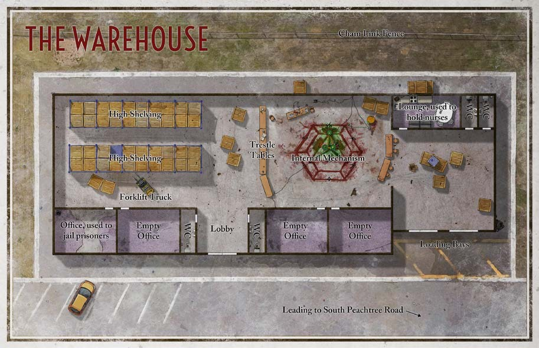

**Склад** (подписи на плане): сетчатый забор; высокие стеллажи (два ряда); погрузчик; козлы-столы; Инфернальный механизм; комната отдыха (там держат медсестёр); туалеты; контора (там держат пленников); пустые конторы; вестибюль; погрузочные ворота; «к Саут-Пичтри-роуд».

*Прим. перев.: на плане подъезд подписан «Leading to South Peachtree Road», а в тексте склад стоит на Лейк-Джун-роуд.*

Окна передних контор, задней комнаты отдыха и туалетов заклеены газетами: внутри ничего не видно, но немного света проникает. Двустворчатые двери спереди деревянные (СИЛ 90, 30 ПЗ) и заперты.

Что сыщики найдут на складе, зависит от того, знает ли Вайпер об их планах (то есть предупредил ли он ЮВ14) или нет (то есть сыщики действуют раньше, чем Вайпер успевает предсказать их действия).

### Если Вайпер знает

Склад вычищен, и ЮВ14 вместе с тремя оживлёнными головами и пленниками перебралась в другое здание по соседству (на другой склад или, на усмотрение Хранителя, например в заброшенный жилой дом). Внутри видно, что банда съезжала в спешке и оставила следы своего пребывания.

На полу можно различить наполовину уничтоженные нарисованные знаки и разметку Инфернального механизма (см. с. 152); похоже, кто-то второпях пытался соскоблить знаки ножом или стамеской.

Нарисованный красной краской знак, похожий на глаз (Око Ньярлатхотепа), повторяется на многих внутренних стенах, создавая жуткую, неприветливую атмосферу. Кажется, будто нарисованные глаза следят за людьми, где бы те ни находились в комнате; если сыщик слишком долго смотрит на глаз (например, тратит время на то, чтобы его рассмотреть), ему может показаться, что глаз моргнул и раскрылся шире, словно пытаясь просверлить его насквозь. Это переживание весьма тревожно — сыщик чувствует, что в его разум вторглись; проверка Рассудка (потеря 1d3/1d6).

Части медицинского оборудования (трубки, пузырьки с лекарствами и прочее) брошены на полу рядом с опрокинутыми столами. Обыск контор и комнаты отдыха показывает, что здесь держали людей: есть царапины (медсестра Мия Торрес отмечала ими дни, проведённые в плену) и окровавленные одеяла.

Если банде пришлось съезжать в спешке, сыщики найдут здесь тела Пиг Пена и других захваченных членов соперничающих банд — их бросили в одной из передних контор. Всех убили как при казни — пулей в голову, и на телах следы пыток: у каждого недостаёт частей тела — пальцев, кистей, ступни, глаза и тому подобного; на самом деле их принесли в жертву головам, а не «пытали» в обычном смысле. Тому, кто разбирается в медицине, ясно, что конечности отрублены мачете или большими ножами. Бетонный пол склада покрыт засохшими пятнами крови, и особенно их много на странных знаках и фигурах, нарисованных на полу (Инфернальном механизме), и вокруг них.

Успешная проверка Внимания обнаруживает на полу маленькую лужицу вязкой зелёной жидкости, липкой на ощупь. Это líquido verde, пролитая членом банды, когда склад вычищали. Другие следы жидкости тоже можно найти на складе.
