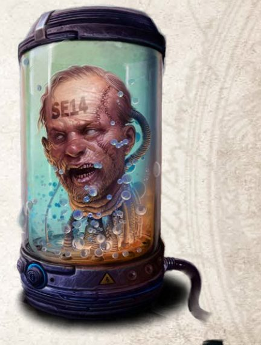

## Конец правления ЮВ14

Уничтожить Инфернальный механизм и убить доктора Лопеса — единственный надёжный способ прекратить этот ужас. Стерев (осквернив) знаки на полу, сыщики уничтожат Инфернальный механизм; хотя «стереть» достаточно двух знаков (один в разметке шестиугольника и один в разметке треугольника), если какие-то из оставшихся знаков уцелеют, доктор Лопес сможет восстановить знаки и снова запустить механизм. Просто уничтожить головы Вайпера, Овер Изи и Ред Хота (разбить их баки, а потом разбить сами неупокоенные головы) — решение лишь временное: на их место можно найти другие головы.

Уничтожить Инфернальный механизм сыщикам должно быть относительно просто, но дело осложняют другие люди и общая обстановка на складе. Если сыщики вдруг растеряются и не будут знать, что делать, Пиг Пен или пойманная снова медсестра могут крикнуть им, чтобы они уничтожили знаки. Возможно, безумие обезумевшего сыщика дарует ему видение того, что нужно сделать, или кто-то из сыщиков случайно испортит один из знаков и поймёт, что надо делать.

Если головы вынести из Инфернального механизма, они продолжают «жить» 1d6+2 часа (но не могут говорить), а потом начинают разлагаться, если не пополнить им запас líquido verde; тогда кожа быстро сползает с черепов, а мозг и глаза разжижаются — свидетелям нужна проверка Рассудка (потеря 1/1d4).

# Итоги

Будем надеяться, сыщикам удастся стереть знаки Инфернального механизма и уничтожить оживлённые головы — это фактически кончает царство террора ЮВ14. Если доктор Лопес убит, сыщики по-настоящему закрыли дело.

Если доктор Лопес выживет, он может когда-нибудь вернуться — безумным и преданным слугой Ньярлатхотепа, стремящимся продолжить свои опыты и усовершенствовать líquido verde.

## Награды

Если вы используете «Голос в трубке» в продолжающейся кампании, сыщики могут получить следующие награды:

- Уничтожить Инфернальный механизм: +1d6 пунктов Рассудка.
- Уничтожить оживлённую голову: +1 пункт Рассудка (не больше 3 пунктов).
- Понять роль доктора Лопеса и не дать ему когда-либо воссоздать Инфернальный механизм: +1d6 пунктов Рассудка.

# Приложение: «Голос в трубке»

## Персонажи Хранителя и чудовища

### ЮВ14 (она же «Юго-Восток Четырнадцать»)

#### Головы банды: Вайпер, Овер Изи и Ред Хот

Кроме того, что они говорят и видят, головы Вайпера, Овер Изи и Ред Хота не могут физически взаимодействовать с окружающим миром.

```stat
СИЛ —     ВЫН 20    ТЕЛ 01    ЛВК —     ИНТ 200*
НАР 01    МОЩ 60    ОБР —     Рассудок 00    ПЗ 2
БкУ: —    Комплекция: 0    Скорость: —    ПМ: 10

* ИНТ Вайпера — отражение разума Ньярлатхотепа. ИНТ Ред Хота и Овер Изи — по 30.
```

*Прим. перев.: при МОЩ 60 по правилам положено 12 ПМ; в оригинале напечатано 10 — оставлено как напечатано.*



*Голова из ЮВ14*
