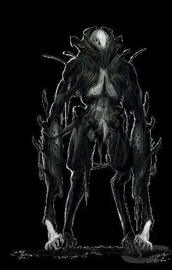

#### Бродяга между измерениями

```stat
СИЛ 95    ВЫН 80    ТЕЛ 95    ЛВК 50    ИНТ 35
НАР —     МОЩ 50    ОБР —     Рассудок —    ПЗ 17
БкУ: +1d6    Комплекция: 2    Скорость: 7    ПМ: 10

Бой
Атак за раунд: 2 (когти или захват)
Ближний бой          45% (22/9), урон 1d8+1d6
Захват (манёвр)      45% (22/9), жертва удержана 1 раунд, затем бродяга исчезает
Уклонение            30% (15/6)

Межпространственное перемещение: может по своей воле покинуть план бытия; перемена начинается с того, что бродяга начинает мерцать и таять; переход стоит 4 пункта магии и длится раунд. В это время бродягу можно атаковать, но сам он не может причинить нападающим урон. Уходя в другое измерение, бродяга может забрать с собой предметы или существ: сжав нужный предмет в когтях и потратив дополнительно 1 пункт магии на каждые 50 пунктов ТЕЛ предмета или существа, он переносит существо или предмет с собой. В этом сценарии бродяга обычно возвращается к Вайперу со всем, что схватил, если ему не велено иное.

Броня: 3 пункта (толстая шкура).
Заклинания: нет (если Хранитель не пожелает иного).
Потеря Рассудка: 0/1d10 пунктов Рассудка при виде бродяги между измерениями.
```

> ### Готовые сыщики-бандиты
>
> Выдайте каждому игроку следующую вводную.
>
> Вы — посвящённый член банды ЮВ13 из Плезант-Гроува на юго-востоке Далласа. Вы подчиняетесь главарю банды Молотило.
>
> Недавно отколовшаяся банда, называющая себя ЮВ14, начала мутить воду в районе и пытается обзавестись своей территорией, что привело к открытой войне. Уличного насилия стало больше, и все в ЮВ13 и ЮВ14 — мишени; другие соседние банды тоже втягиваются в эту заваруху и попадают под перекрёстный огонь.


