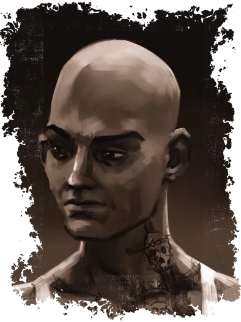

## Копатель (Антонио Хименес)

**Возраст:** 26 лет. **Род занятий:** бандит ЮВ13.



```stat
СИЛ 80    ВЫН 65    ТЕЛ 60    ЛВК 70    ИНТ 70
НАР 65    МОЩ 60    ОБР 45    Рассудок 60    ПЗ 12
БкУ: +1d4    Комплекция: 1    Скорость: 9    ПМ: 12    Удача: 60

Особое свойство: невосприимчив к потере Рассудка от «обычной» жестокости.

Бой
Ближний бой (драка)        65% (32/13), урон 1d3+1d4
Большой нож                60% (30/12), урон 1d8+1d4
Револьвер .32              50% (25/10), урон 1d8
Уклонение                  35% (17/7)

Навыки
Обаяние 55% (27/11)
Лазание 60% (30/12)
Средства 10% (5/2)
Вождение автомобиля 50% (25/10)
Стрельба (пистолет) 50% (25/10)
Стрельба (винтовка/дробовик) 25% (12/5)
Стрельба (пистолет-пулемёт) 30% (15/6)
Запугивание 50% (25/10)
Прыжки 20% (10/4)
Язык (испанский) 60% (30/12)
Язык (английский) 45% (22/9)
Слух 25% (12/5)
Взлом 30% (15/6)
Механика 45% (22/9)
Психология 40% (20/8)
Внимание 30% (15/6)
Скрытность 30% (15/6)
Метание 40% (20/8)

Бонус: распределите 20 пунктов между любыми навыками на выбор игрока.
```

*Прим. перев.: у большого ножа в оригинале напечатано «60% (32/13)» — половина и пятая подходят к 65%; в официальном переводе и здесь — 60% (30/12).*

**Предыстория.** Вас уважают в банде, где вы завоевали себе место, лично устранив лидера конкурирующей группировки. Ваш норов — основная сила и главная слабость: вы рискуете и иногда выигрываете по-крупному, но может прийти день, когда вы проиграете. А пока жизнь прекрасна: у вас есть деньги в кармане и Принцесса подле вас. Молотило, ваш босс, кажется старым и слабым — возможно, пришло время взять власть в свои руки.

- **Описание:** мускулистый, с бритой головой и крупными татуировками банды на верхней части туловища и шее.
- **Черты характера:** рисковый и упрямый, быстро выходит из себя.
- **Мировоззрение/убеждения:** ты сам творец своей жизни, ищи возможности и используй их.
- **Значимые люди:** Принцесса, ваша девушка. Вы помогли ей пристрелить убийцу её сестры.

**Заметки игрока:**
