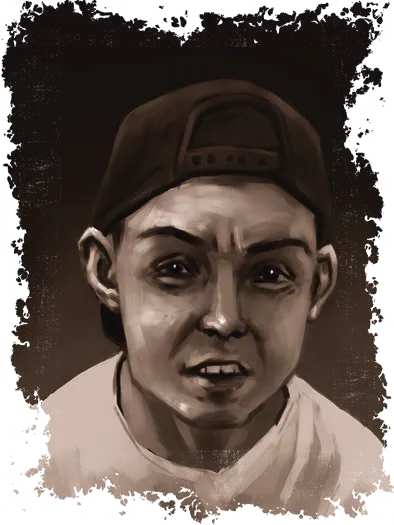

## Тако (Эмилио Кастильо)

**Возраст:** 19 лет. **Род занятий:** бандит ЮВ13.



```stat
СИЛ 55    ВЫН 80    ТЕЛ 45    ЛВК 70    ИНТ 80
НАР 70    МОЩ 55    ОБР 55    Рассудок 55    ПЗ 12
БкУ: 0    Комплекция: 0    Скорость: 8    ПМ: 11    Удача: 50

Особое свойство: невосприимчив к потере Рассудка от «обычной» жестокости.

Бой
Ближний бой (драка)        45% (22/9), урон 1d3
Карманный нож              45% (22/9), урон 1d4
Пистолет .38               40% (20/8), урон 1d10
Уклонение                  35% (17/7)

Навыки
Обаяние 60% (30/12)
Лазание 60% (30/12)
Средства 10% (5/2)
Вождение автомобиля 30% (15/6)
Электрика 15% (7/3)
Стрельба (пистолет) 40% (20/8)
Стрельба (винтовка/дробовик) 25% (12/5)
Стрельба (пистолет-пулемёт) 20% (10/4)
Запугивание 25% (12/5)
Прыжки 45% (22/9)
Язык (испанский) 60% (30/12)
Язык (английский) 50% (25/10)
Слух 50% (25/10)
Механика 30% (15/6)
Естествознание 30% (15/6)
Психология 35% (17/7)
Наука (биология) 20% (10/4)
Наука (математика) 35% (17/7)
Внимание 30% (15/6)
Скрытность 40% (20/8)
Метание 50% (25/10)

Бонус: распределите 20 пунктов между любыми навыками на выбор игрока.
```

*Прим. перев.: у английского в оригинале напечатано «50% (22/9)» — половина и пятая подходят к 45%; в официальном переводе и здесь — 50% (25/10). Скорость 8 — как в оригинале и официальном переводе, хотя по правилам (СИЛ 55, ЛВК 70, ТЕЛ 45, 19 лет) выходит 9.*

**Предыстория.** Вы пытаетесь вести себя как «криминальный авторитет», которых видели в кино, но это часто срабатывает против вас. Ваши собратья по банде считают, что вы только болтать горазды. Вы считаете, что заслужили своё место, но никто не воспринимает вас всерьёз, так что вы мечтаете найти способ доказать свою удаль и завоевать уважение банды. Все знают, что вы умны, но вы хотите, чтобы вас боялись.

- **Описание:** очень короткие волосы под бейсболкой, рост ниже среднего, ребяческое лицо.
- **Черты характера:** шутник; пытается сдерживаться, но иногда так сложно не повалять дурака.
- **Мировоззрение/убеждения:** хочет завоевать уважение других членов банды любой ценой.
- **Ценное имущество:** ваш пистолет — пропуск во взрослую жизнь.

**Заметки игрока:**
