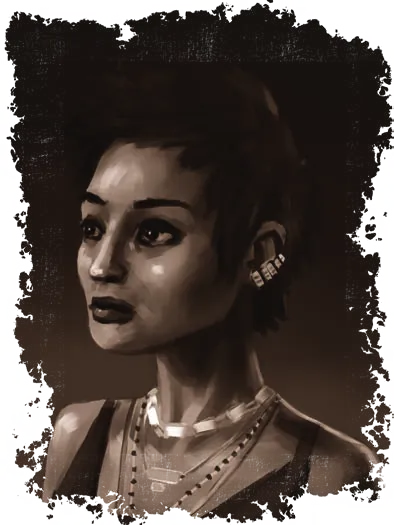

## Везучая (Элена Вега)

**Возраст:** 23 года. **Род занятий:** бандитка ЮВ13.



```stat
СИЛ 45    ВЫН 70    ТЕЛ 45    ЛВК 85    ИНТ 85
НАР 65    МОЩ 60    ОБР 65    Рассудок 60    ПЗ 11
БкУ: 0    Комплекция: 0    Скорость: 8    ПМ: 12    Удача: 80

Особое свойство: невосприимчива к потере Рассудка от «обычной» жестокости.

Бой
Ближний бой (драка)        50% (25/10), урон 1d3
Средний нож                50% (25/10), урон 1d4+2
Пистолет .22               35% (17/7), урон 1d6
Газовый баллончик          50% (25/10), шок на 1d6 раундов
Уклонение                  50% (25/10)

Навыки
Искусство/ремесло (актёрская игра) 45% (22/9)
Обаяние 60% (30/12)
Лазание 40% (20/8)
Средства 10% (5/2)
Вождение автомобиля 30% (15/6)
Красноречие 50% (25/10)
Стрельба (пистолет) 35% (17/7)
Стрельба (винтовка/дробовик) 25% (12/5)
Стрельба (пистолет-пулемёт) 15% (7/3)
Запугивание 50% (25/10)
Прыжки 25% (12/5)
Язык (испанский) 65% (32/13)
Язык (английский) 60% (30/12)
Слух 45% (22/9)
Взлом 25% (12/5)
Оккультизм 40% (20/8)
Психология 40% (20/8)
Внимание 45% (22/9)
Скрытность 55% (27/11)
Метание 30% (15/6)

Бонус: распределите 20 пунктов между любыми навыками на выбор игрока.
```

*Прим. перев.: в оригинале напечатано «Комплекция: 9» — опечатка (СИЛ 45 + ТЕЛ 45 = 90 — Комплекция 0); в официальном переводе и здесь — 0.*

**Предыстория.** Вы всегда знали, что окажетесь в банде, как и ваш брат до вас. Теперь, когда брат в тюрьме, банда — ваша единственная семья (родители вышвырнули вас на улицу давным-давно). Теперь вы должны сами заботиться о себе, и вы скорее умрёте, чем позволите мужчинам себя недооценивать: тем немногим недоумкам, которые посчитали, что смогут вас контролировать, эта ошибка дорого обошлась.

- **Описание:** короткие жёсткие волосы, много украшений, длинные крашеные ногти.
- **Черты характера:** жестокая, расчётливая и бесстрашная.
- **Мировоззрение/убеждения:** банда — ваша семья, без неё вам не жить.
- **Значимые люди:** ваш брат Джем, который всегда приходил вам на выручку.

**Заметки игрока:**
