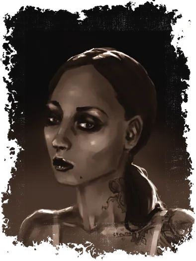

## Принцесса (Лусия Ривера)

**Возраст:** 21 год. **Род занятий:** бандитка ЮВ13.



```stat
СИЛ 60    ВЫН 65    ТЕЛ 50    ЛВК 70    ИНТ 75
НАР 80    МОЩ 70    ОБР 60    Рассудок 70    ПЗ 11
БкУ: 0    Комплекция: 0    Скорость: 8    ПМ: 14    Удача: 50

Особое свойство: невосприимчива к потере Рассудка от «обычной» жестокости.

Бой
Ближний бой (драка)        45% (22/9), урон 1d3
Опасная бритва             45% (22/9), урон 1d4+1
Пистолет .32               45% (22/9), урон 1d8
Уклонение                  55% (27/11)

Навыки
Обаяние 55% (27/11)
Лазание 30% (15/6)
Работа с компьютером 35% (17/7)
Средства 10% (5/2)
Вождение автомобиля 25% (12/5)
Красноречие 65% (32/13)
Стрельба (пистолет) 45% (22/9)
Стрельба (винтовка/дробовик) 25% (12/5)
Стрельба (пистолет-пулемёт) 15% (7/3)
Первая помощь 40% (20/8)
Прыжки 25% (12/5)
Язык (испанский) 60% (30/12)
Язык (английский) 60% (30/12)
Слух 35% (17/7)
Естествознание 30% (15/6)
Психология 45% (22/9)
Чтение по губам 30% (15/6)
Внимание 55% (27/11)
Скрытность 50% (25/10)
Метание 25% (12/5)

Бонус: распределите 20 пунктов между любыми навыками на выбор игрока.
```

*Прим. перев.: Скорость 8 — как в оригинале и официальном переводе, хотя по правилам (СИЛ 60, ЛВК 70, ТЕЛ 50, 21 год) выходит 9. Официальный перевод называет бритву «клинковой».*

**Предыстория.** Вы жили обычной жизнью, стараясь ни во что не ввязываться, когда вашу младшую сестрёнку убило шальной пулей, предназначенной не ей. Вас охватило отчаяние, и ваша семья не смогла помочь справиться с той болью, которую вы испытывали. Так что вы обратились к парням с улицы, благодаря которым снова почувствовали себя сильной. Вы присоединились к банде и с помощью вашей новой семьи прострелили голову человека, который убил вашу сестру. Но иногда вы хотите оставить эту полную насилия жизнь позади.

- **Описание:** длинные тёмные волосы (обычно собранные в хвост), обильный макияж, разные татуировки на руке и шее.
- **Черты характера:** не любит отступать и терять лицо, сыплет обвинениями.
- **Мировоззрение/убеждения:** око за око — звучит логично.
- **Значимые люди:** Копатель, ваш парень. Он помог вам выследить и прикончить убийцу вашей сестры.

**Заметки игрока:**
