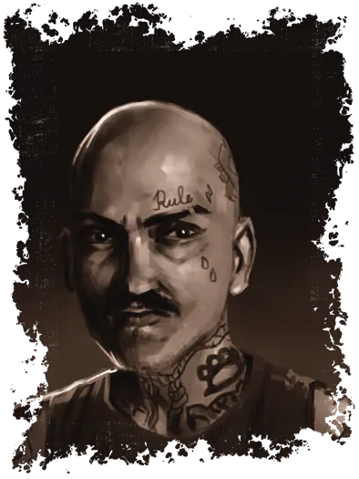

## Мороз (Тайлер Вашингтон)

**Возраст:** 32 года. **Род занятий:** бандит ЮВ13.



```stat
СИЛ 70    ВЫН 90    ТЕЛ 55    ЛВК 55    ИНТ 80
НАР 60    МОЩ 60    ОБР 65    Рассудок 60    ПЗ 14
БкУ: +1d4    Комплекция: 1    Скорость: 7    ПМ: 12    Удача: 45

Особое свойство: невосприимчив к потере Рассудка от «обычной» жестокости.

Бой
Ближний бой (драка)        60% (30/12), урон 1d3+1d4
Мачете                     60% (30/12), урон 1d8+1d4
Пистолет .38               55% (27/11), урон 1d10
Уклонение                  27% (13/5)

Навыки
Лазание 35% (17/7)
Работа с компьютером 30% (15/6)
Средства 10% (5/2)
Вождение автомобиля 45% (22/9)
Стрельба (пистолет) 55% (27/11)
Стрельба (винтовка/дробовик) 30% (15/6)
Стрельба (пистолет-пулемёт) 25% (12/5)
Запугивание 50% (25/10)
Прыжки 40% (20/8)
Язык (испанский) 65% (32/13)
Язык (английский) 60% (30/12)
Работа в библиотеке 45% (22/9)
Слух 40% (20/8)
Механика 35% (17/7)
Убеждение 40% (20/8)
Психология 50% (25/10)
Внимание 50% (25/10)
Скрытность 55% (27/11)
Метание 35% (17/7)

Бонус: распределите 20 пунктов между любыми навыками на выбор игрока.
```

*Прим. перев.: Скорость 7 — как в оригинале и официальном переводе, хотя по правилам (СИЛ 70, ЛВК 55, ТЕЛ 55, 32 года) выходит 8.*

**Предыстория.** Вы крепкий орешек. Вас прозвали Морозом, потому что вы хладнокровны и не испытываете угрызений совести. Жизнь на улицах научила вас одному: убей или будешь убит. Вы обязаны жизнью собратьям по банде и возвращаете долг каждый день — верность банде для вас всё. Вы без промедления избавитесь от любого, кто проявит неуважение к вам и вашей «семье».

- **Описание:** бритая голова, усы, крупные татуировки банды на верхней части туловища, шее и лице.
- **Черты характера:** хладнокровный, сухой.
- **Мировоззрение/убеждения:** бескомпромиссно предан банде.
- **Значимые люди:** Молотило, лидер ЮВ13, которого вы безмерно уважаете.

**Заметки игрока:**
