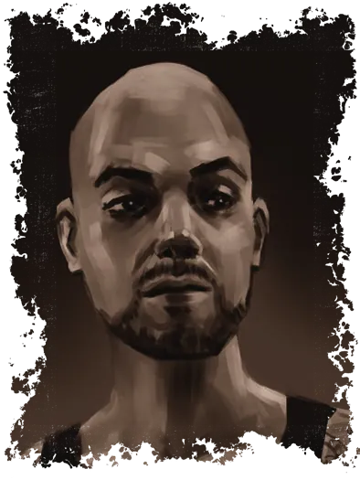

## Циркулярка (Лукас Рейес; настоящее имя — Габриель Монтес)

**Возраст:** 24 года. **Род занятий:** бандит ЮВ13 (полицейский под прикрытием).



```stat
СИЛ 70    ВЫН 75    ТЕЛ 65    ЛВК 60    ИНТ 85
НАР 50    МОЩ 60    ОБР 80    Рассудок 60    ПЗ 14
БкУ: +1d4    Комплекция: 1    Скорость: 7    ПМ: 11    Удача: 55

Особое свойство: невосприимчив к потере Рассудка от «обычной» жестокости.

Бой
Ближний бой (драка)        60% (30/12), урон 1d3+1d4
Пистолет «Глок 17»         60% (30/12), урон 1d10
Уклонение                  30% (15/6)

Навыки
Искусство/ремесло (актёрская игра) 55% (27/11)
Обаяние 35% (17/7)
Лазание 30% (15/6)
Работа с компьютером 35% (17/7)
Средства 10% (5/2)
Маскировка 65% (32/13)
Вождение автомобиля 45% (22/9)
Электрика 20% (10/4)
Красноречие 55% (27/11)
Первая помощь 50% (25/10)
Стрельба (пистолет) 60% (30/12)
Стрельба (винтовка/дробовик) 45% (22/9)
Стрельба (пистолет-пулемёт) 25% (12/5)
Запугивание 35% (17/7)
Прыжки 25% (12/5)
Язык (испанский) 80% (40/16)
Язык (английский) 70% (35/14)
Работа в библиотеке 30% (15/6)
Слух 45% (22/9)
Психология 40% (20/8)
Внимание 55% (27/11)
Скрытность 50% (25/10)
Метание 35% (17/7)

Бонус: распределите 20 пунктов между любыми навыками на выбор игрока.
```

*Прим. перев.: в оригинале на листе — «Lucas Reyes», настоящее имя «Gabriel Montez», а в списке готовых сыщиков (с. 154) — «Gabriel Reyes»; в официальном переводе — Габриель Монтес. ПМ 11 при МОЩ 60 (по правилам 12) и Скорость 7 (по правилам 8) — как в оригинале и официальном переводе. Glock 17 — модель пистолета (9 мм); в официальном переводе ошибочно «„Глок“ 17-го калибра».*

**Предыстория.** Вскоре после выпуска из полицейской академии вас отправили под прикрытием в ряды ЮВ13, могущественной преступной группировки в районе Далласа Плезант-Гроув. Вы провели в банде два года, завоёвывая доверие и устанавливая отношения. Пока вам удалось никого не убивать, но несколько раз вы были близки к этому, чтобы не разоблачить себя. Иногда у вас в голове всё смешивается, и вы забываете, что вы полицейский. Вы хотите покинуть банду, но начальство считает, что вы собираете слишком важную информацию. Вы знаете, что рано или поздно судьба поставит вас перед трудным выбором между верностью банде и верностью полиции, — на чью сторону вы склонитесь, когда это произойдёт?

- **Описание:** широкоплечий, с бритой головой, эспаньолкой и несколькими небольшими татуировками банды на предплечьях.
- **Черты характера:** наблюдательный, в группе играет роль сорвиголовы.
- **Мировоззрение/убеждения:** вы ненавидите преступную культуру и хотите снова вернуться к нормальной жизни.
- **Ценное имущество:** кулон с изображением святого Христофора, который вам подарил отец.

**Заметки игрока:**
