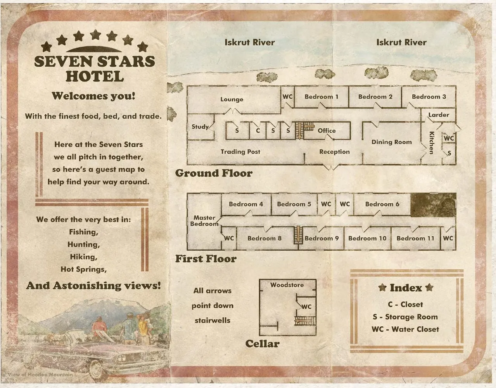

# Приложение 1. Раздатки

> **Раздатка «Материал: отель 1. План отеля „Семь звёзд“»**
>
> **Отель «Семь звёзд» приветствует вас!**
> Лучшая еда, постель и торговый пост!
>
> В отеле «Семь звёзд» мы стараемся для вашего удобства и предлагаем гостям этот план, чтобы им было проще находить дорогу.
>
> У нас вы найдёте лучшую рыбалку, лучшую охоту, лучшие прогулки, горячие источники и потрясающие виды!
>
> | На плане | Перевод |
> |---|---|
> | Iskrut River | Река Искут |
> | Ground Floor | Первый этаж: холл, библиотека, чуланы (Ч), шкаф (Ш), офис, торговый пост, фойе, столовая, кухня, кладовка, уборные (У), номера 1–3 |
> | First Floor | Второй этаж: хозяйская спальня, номера 4–6 и 8–11, уборные (номер 7 закрашен) |
> | Cellar | Подвал: склад поленьев, уборная |
> | All arrows point down stairwells | Все стрелки указывают вниз по лестницам |
> | Index: C — Closet; S — Storage Room; WC — Water Closet | Обозначения: Ч — чулан; Ш — шкаф (кладовая); У — уборная |

*Текст раздатки — по официальному русскому изданию раздаток «Кошмаров цифровой эпохи». Прим. перев.: на плане река подписана «Iskrut River» — опечатка; в тексте — Iskut (Искут). Внизу буклета — старинная открытка с машиной и туристами на фоне горы Худу.*
