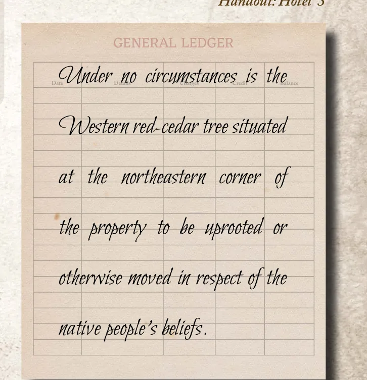

> **Раздатка «Материал: отель 2. Похищение солнечного света»**
>
> Как Ворон украл звёзды, луну и солнце.
>
> Старик был очень богат и владел тремя коробами, где лежали звёзды, луна и солнце. Но Ворон хотел забрать их себе, так что он превратился в сосновую иголку и прыгнул в чашку воды дочери Старика, когда она собирала ягоды. Выпив воды из чашки, дочь Старика забеременела и родила Ворона как маленького мальчика.
>
> Старик обожал внука, но ребёнок всё время безутешно плакал, пока Старик не дал ему поиграть короб со звёздами. Мальчик (Ворон) открыл короб, и звёзды через дымоход уплыли на небо. Через какое-то время ребёнок принялся плакать и просить дать ему короб с луной. Старик после долгих колебаний отдал его, но сначала заткнул дымоход. Мальчик стал играть с коробом, тот выкатился за дверь, и луна уплыла в небо. Но ребёнок продолжал плакать, требуя короб с солнцем. Старик долго отказывался, но в конце концов отдал короб мальчику и стал пристально за ним приглядывать. Мальчик же дождался, пока все заснут, а потом превратился в птицу, схватил короб клювом и вылетел наружу через дымоход. Ворон забрал короб, чтобы доказать всем, что у него есть солнце, но случайно открыл крышку, и солнце вылетело в небо, где и находится по сей день.

<!-- -->

> **Раздатка «Материал: отель 4. Ритуальные фразы»**
>
> *Примечание: каждая из следующих фраз написана на одном из семи кошмарных пейзажей Шигля. См. «Правильный порядок ритуальных фраз», с. 31.*
>
> Нг’ааааа, нг’аааа.
>
> Азатот! Йа!
>
> Финн-ай, Игаг-ролл, н’гркдл’лх.
>
> Игнаиих, йгнайих, тотх’нгха! Йог-Сотот!
>
> И’бтнк, х’ехйе — н’гркдл’лх.
>
> Эх-йахаах, е’йайайайаааа.
>
> Хин-лаггарр, йеста, йеста.

*Тексты раздаток — по официальному русскому изданию раздаток «Кошмаров цифровой эпохи»; примечание к «Материалу: отель 4» переведено по этой странице оригинала (в русском издании там совет разрезать фразы).*

> **Раздатка «Материал: отель 3. Бухгалтерская книга»**
>
> БУХГАЛТЕРСКАЯ КНИГА
>
> *Ни при каких обстоятельствах нельзя выкорчёвывать или как-то иначе перемещать тую, растущую у северо-восточного угла участка, из уважения к верованиям местного народа.*
