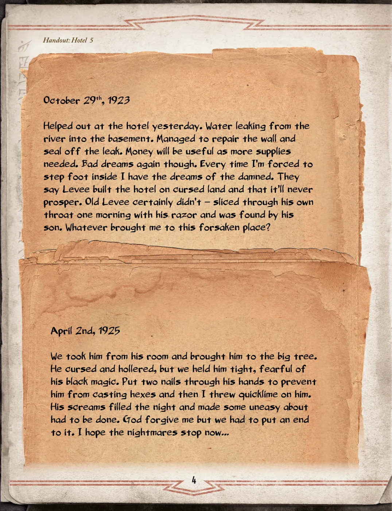

> **Раздатка «Материал: отель 5. Дневник поселенца»**
>
> *29 октября 1923*
>
> Вчера помогал в отеле. Вода из реки просочилась в подвал. Смогли починить стену и устранить протечку. Деньги не помешают, потому что нужны припасы. Но снова мучили кошмары. Каждый раз, когда приходится туда заходить, я потом вижу сны о проклятых душах. Говорят, Леви построил отель на дурной земле и тот никогда не будет процветать. Старому Леви это точно не принесло добра — как-то утром сынок нашёл его с перерезанным горлом. И что меня понесло в это Богом забытое место?
>
> *2 апреля 1925*
>
> Мы выволокли его из комнаты и потащили к большому дереву. Он ругался и орал, но мы держали его крепко, опасаясь злых чар. Забили два гвоздя в ладони, чтобы не дать ему творить заклинания, а потом я посыпал его негашёной известью. Его крики заполнили ночь, и некоторым стало не по себе от того, что мы должны были сделать. Да простит меня Бог, но этому нужно было положить конец. Надеюсь, теперь кошмары прекратятся...

*Текст раздатки — по официальному русскому изданию раздаток «Кошмаров цифровой эпохи».*
