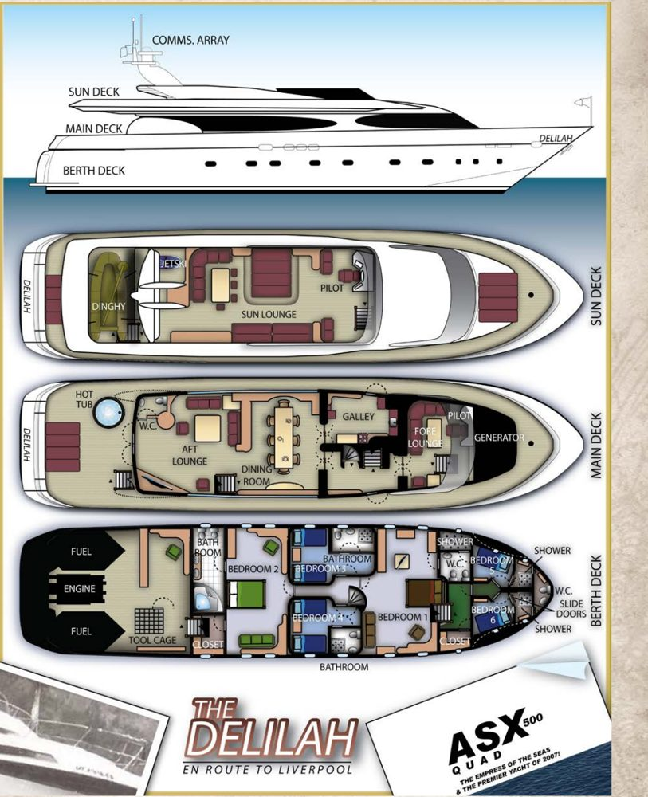

> **Раздатка «Материал: заброшенный корабль 1»: план палуб «Далилы»**
>
> *Разрез яхты сбоку и планы трёх палуб — солнечной, главной и нижней; внизу — фотография яхты, логотип «The Delilah — en route to Liverpool» и рекламный буклет «ASX 500 Quad — императрица морей и лучшая яхта 2007 года!».*
>
> | На плане | Перевод |
> |---|---|
> | Comms. array | антенны связи |
> | Sun deck / Main deck / Berth deck | солнечная палуба / главная палуба / нижняя (жилая) палуба |
> | Delilah | «Далила» (название на борту) |
> | Dinghy · Jetski · Sun lounge · Pilot | шлюпка · гидроцикл · зона отдыха · дублирующий пост управления |
> | Hot tub · W.C. · Aft lounge · Dining room · Galley · Fore lounge · Pilot · Generator | гидромассажная ванна · туалет · кормовой салон · столовая · камбуз · носовой салон · рулевая рубка · генератор |
> | Fuel · Engine · Tool cage | топливо · двигатель · инструментальная клеть |
> | Bedroom 1–6 · Bathroom · Shower · W.C. · Closet · Slide doors | каюты 1–6 · ванная · душ · туалет · шкаф · раздвижные двери |
> | The Delilah — en route to Liverpool | «Далила» — курсом на Ливерпуль |
