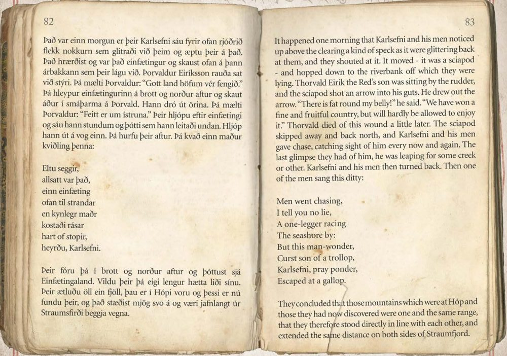

> **Раздатка «Материал: заброшенный корабль 3»: страницы «Саги об Эйрике Рыжем»**
>
> *Слева (с. 82) — древнеисландский текст саги, справа (с. 83) — английский перевод того же отрывка.*
>
> **82**
>
> Það var einn morgun er þeir Karlsefni sáu fyrir ofan rjóðrið flekk nokkurn sem glitraði við þeim og æptu þeir á það. Það hrærðist og var það einfætingur og skaust ofan á þann árbakkann sem þeir lágu við. Þorvaldur Eiríksson rauða sat við stýri. Þá mælti Þorvaldur: “Gott land höfum vér fengið.” Þá hleypur einfætingurinn á brott og norður aftur og skaut áður í smáþarma á Þorvald. Hann dró út örina. Þá mælti Þorvaldur: “Feitt er um ístruna.” Þeir hljópu eftir einfætingi og sáu hann stundum og þótti sem hann leitaði undan. Hljóp hann út á vog einn. Þá hurfu þeir aftur. Þá kvað einn maður kviðling þenna:
>
> Eltu seggir, / allsatt var það, / einn einfæting / ofan til strandar / en kynlegr maðr / kostaði rásar / hart of stopir, / heyrðu, Karlsefni.
>
> Þeir fóru þá í brott og norður aftur og þóttust sjá Einfætingaland. Vildu þeir þá eigi lengur hætta liði sínu. Þeir ætluðu öll ein fjöll, þau er í Hópi voru og þessi er nú fundu þeir, og það stæðist mjög svo á og væri jafnlangt úr Straumsfirði beggja vegna.
>
> **83**
>
> Однажды утром Карлсефни и его люди увидели на дальней стороне прогалины какое-то пятнышко, которое поблёскивало, и они закричали на него. Пятнышко зашевелилось, и это оказался одноногий человек, который бросился скачками туда, где стоял их корабль. Торвальд, сын Эйрика Рыжего, сидел у руля. Одноножка попал ему стрелой в низ живота. Торвальд выдернул стрелу и сказал:
> — Богатую страну мы нашли. Жиром обросли мои кишки.
> Вскоре после этого Торвальд умер от раны. Одноножка бросился убегать на север. Карлсефни и его люди погнались за ним и по временам видели, как он убегал от них. Наконец он скрылся от них в какой-то бухте, и они повернули назад. Тогда один из них произнёс такой стишок:
>
> Воины гнались — / Говорю я правду — / За одноножкой / Вниз к берегу. / Чудной человек / Мчался как вихрь / По бездорожью. / Слушай, Карлсефни!
>
> Затем они поплыли снова на север и считали, что они в Стране Одноножек. Но они решили больше не подвергать опасности своих людей. Они полагали, что горы у Озерка и те, которые они теперь видели, это одни и те же горы и что обе местности одинаково отстоят от Оточного Фьорда.

*Текст правой страницы — официальный русский перевод из раздаток «Кошмаров цифровой эпохи» («Материал: заброшенный корабль 3»). Прим. перев.: на этой странице оригинала раздатка подписана «Handout: Derelict 2», а в главе «Заброшенный корабль» — «Handout: Derelict 3»; в английском переводе саги одноногий назван «sciapod» (скиапод).*
