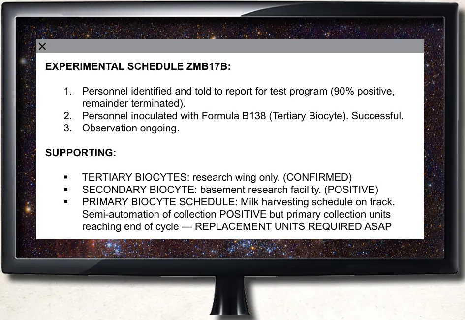

> **Раздатка «Панацея» 2**
>
> **График эксперимента ЗМБ17Б:**
>
> 1. Сотрудники идентифицированы и получили распоряжение принять участие в программе испытаний (90% успешно, остальные устранены).
> 2. Сотрудникам введена формула Б138 (третичный биоцит). Успешно.
> 3. Наблюдение продолжается.
>
> **Поддержание:**
>
> - ТРЕТИЧНЫЕ БИОЦИТЫ: только исследовательское крыло. (Подтверждено)
> - ВТОРИЧНЫЙ БИОЦИТ: подвал исследовательского крыла. (Положительно)
> - ГРАФИК ПЕРВИЧНОГО БИОЦИТА: график забора молока налажен. Полуавтоматический забор ПОЛОЖИТЕЛЬНО, но первичные агрегаты забора достигают конца рабочего цикла — СРОЧНО ЗАМЕНИТЬ АГРЕГАТЫ ЗАБОРА.

*Текст раздатки — по официальному русскому изданию раздаток «Кошмаров цифровой эпохи». Прим. перев.: в оригинале вторичный биоцит — «basement research facility» (исследовательская лаборатория в подвале).*
