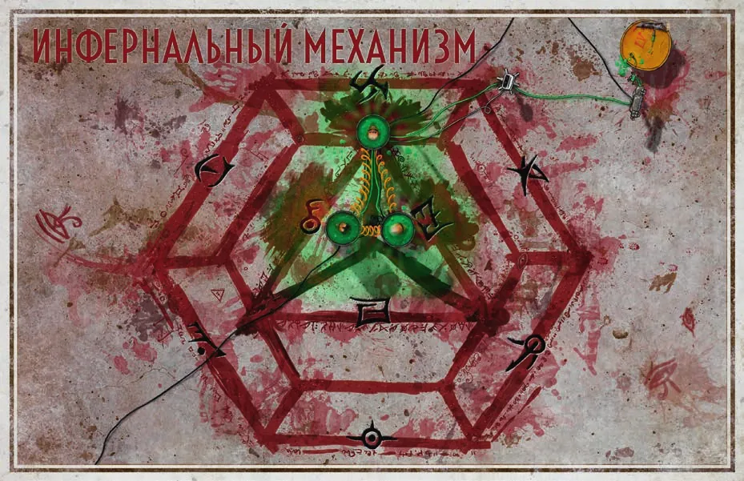
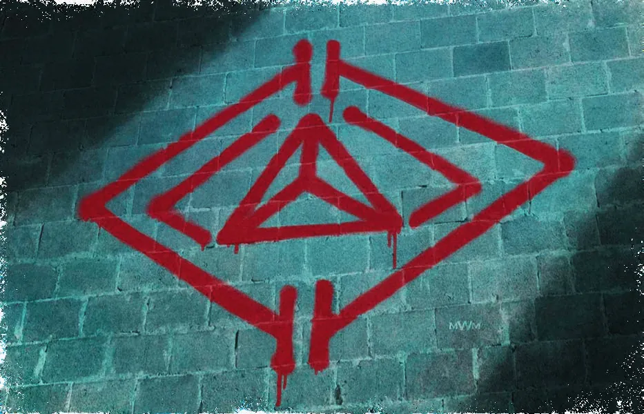

> **Раздатка «Материал: голос 1 — Инфернальный механизм»**
>
> *Нарисованный на бетонном полу склада шестиугольник с треугольником внутри, забрызганный кровью; в сегментах — чёрные знаки, в центре — три головы в баках, от них тянутся провода. Надпись: «Инфернальный механизм».*

<!-- -->

> **Раздатка «Материал: голос 2 — Око Ньярлатхотепа»**
>
> *Знак, похожий на стилизованный глаз, нарисованный красной краской на стене из шлакоблоков.*

*Прим. перев.: подпись первой раздатки в оригинале — «Handout: Voice 1`» (с лишним знаком).*
