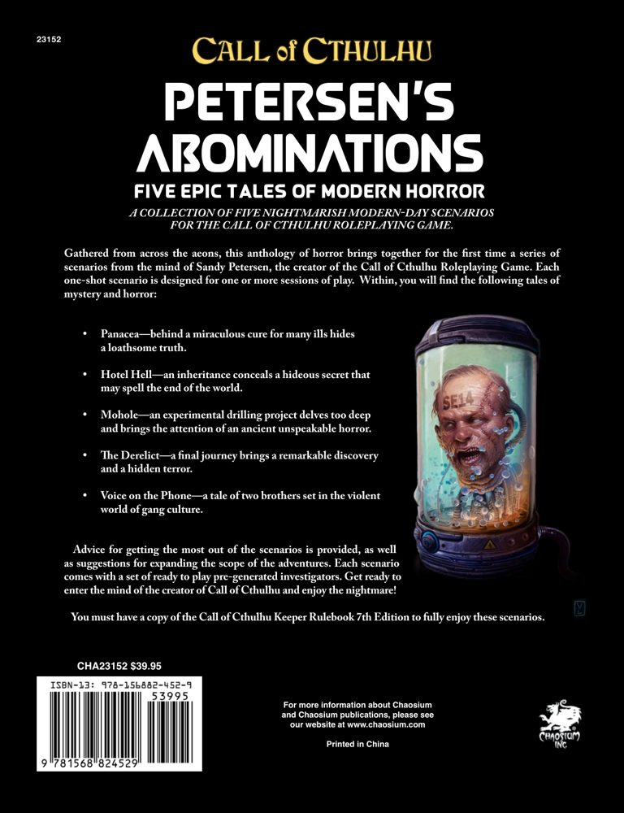

Зов Ктулху

Кошмары цифровой эпохи

Пять эпических историй современного ужаса

*Сборник из пяти кошмарных сценариев в наши дни для ролевой игры «Зов Ктулху».*

**Собранная сквозь эпохи, эта антология ужаса впервые объединяет сценарии, рождённые воображением Сэнди Петерсена — создателя ролевой игры «Зов Ктулху». Каждый сценарий рассчитан на одну или несколько игровых встреч. Внутри вас ждут следующие истории тайн и ужаса:**

- **«Панацея»** — за чудесным лекарством от многих недугов скрывается омерзительная правда.
- **«Адский отель»** — наследство таит чудовищную тайну, которая может означать конец света.
- **«Мохол»** — экспериментальное бурение уходит слишком глубоко и привлекает внимание древнего неописуемого ужаса.
- **«Заброшенный корабль»** — последнее плавание приводит к удивительной находке и скрытому ужасу.
- **«Голос в трубке»** — повесть о двух братьях в жестоком мире бандитской культуры.

**В книге даны советы, как извлечь из сценариев максимум, и предложения, как расширить рамки приключений. К каждому сценарию прилагается набор готовых к игре сыщиков. Приготовьтесь заглянуть в разум создателя «Зова Ктулху» и насладиться кошмаром!**

**Чтобы в полной мере насладиться этими сценариями, вам понадобится «Книга хранителя» «Зова Ктулху» 7-й редакции.**

CHA23152 · 39,95 доллара · ISBN-13: 978-156882-452-9

Подробнее о Chaosium и её изданиях — на сайте www.chaosium.com. Напечатано в Китае.
