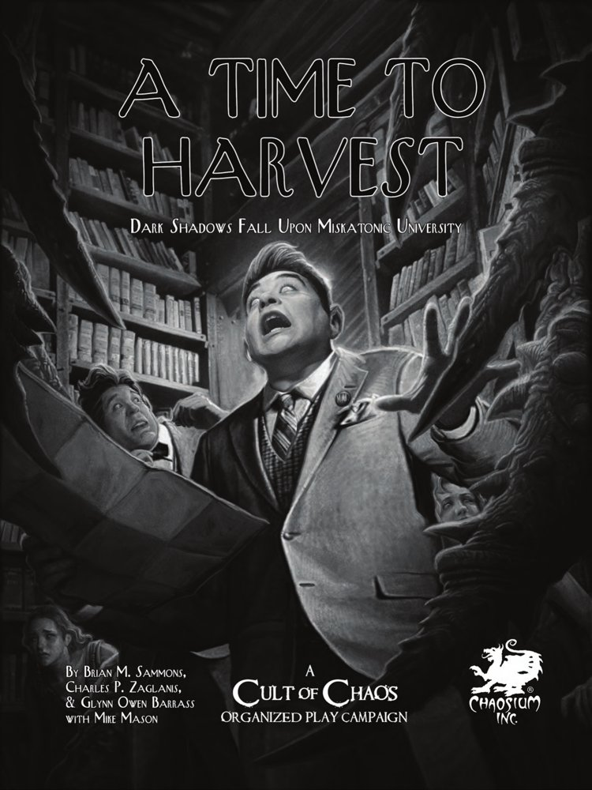

ВРЕМЯ ЖАТВЫ

Тёмные тени падают на Мискатоникский университет

Брайан М. Сэммонс, Чарльз П. Заглэнис, Глинн Оуэн Баррасс при участии Майка Мейсона

*На обложке (художник — Виктор Леза) — книгохранилище библиотеки: полный мужчина в костюме в ужасе отшатывается от чего-то, что тянется к нему из-за стеллажей; позади прячутся двое студентов. Надписи: «A Time to Harvest» («Время жатвы»), «Dark Shadows Fall Upon Miskatonic University» («Тёмные тени падают на Мискатоникский университет»), имена авторов — Brian M. Sammons, Charles P. Zaglanis, & Glynn Owen Barrass with Mike Mason; «A Cult of Chaos Organized Play Campaign» («Кампания организованной игры „Культ Хаоса“»); логотип Chaosium Inc.*
