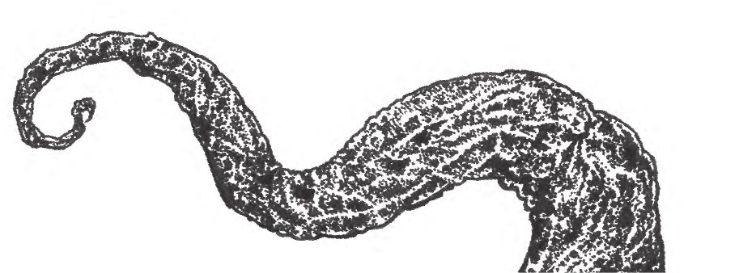

Луны. Если эти Врата будут достроены, они станут огромным постоянным путём, по которому ми-го смогут приходить и уходить когда пожелают. Более того, чуждая наука, на которой основано устройство Врат, такова, что питаться они будут энергией Земли — и превратят нашу планету в почерневший обугленный ком камня, лишённый жизни.

## Возможности и угрозы

FOC обратилась к профессору Эшли Лирмонту, видному металлургу, за помощью в изучении паскуаллия. Благодаря этой работе Лирмонт увидел возможности как для себя, так и для Мискатоникского университета. Лирмонт сыграл ключевую роль в том, чтобы добыть спонсорство и места для своих студентов-естественников в вермонтской экспедиции. Лирмонт знает и о новой предстоящей экспедиции и снова устроил корпоративное спонсорство со стороны очень услужливых людей из FOC.

Правда о паскуаллии в том, что его нашли в давно заброшенной шахте ми-го в Вермонте. Сама заброшенная шахта для ми-го не особенно важна: холмы они уже в основном выработали. Беда в том, что заброшенные выработки находятся в Брокен-Хилле, рядом с Коббс-Корнерс. Эта старая шахта соединяется с базой ми-го под соседним Раунд-Хиллом. Грибы не хотят, чтобы назойливые люди обнаружили их главный форпост в этих краях, и покинут его лишь в крайнем случае.

Ми-го нужны студенты Мискатоникского университета, чтобы использовать их как агентов (своего рода), которые вернут из университета все сколько-нибудь важные свидетельства о паскуаллии. Ми-го намерены извлечь живые мозги из участников последней экспедиции и использовать их тела как вместилища для мозгов союзников ми-го, которые уже у них в руках. Настолько безупречно замаскированные агенты предпочтительнее, ведь ми-го не хотят привлекать лишнего внимания, сами появляясь в крупном населённом пункте. Не хотят Грибы и рисковать в таком опасном предприятии немногими ценными (и целиком невредимыми) союзниками-людьми. Знакомые студенты привлекают в университете куда меньше внимания, чем мог бы надеяться любой посторонний.

Когда все вещественные свидетельства будут изъяты из Мискатоникского университета, ми-го обратят внимание на FOC и её владельца-миллионера, мистера Майкла Абеларда.

## «Федерейтед Ойл энд Кемикал» (FOC)

Огромная международная компания, основанная в 1908 году; FOC занимается добычей полезных ископаемых — нефти, угля, природного газа и прочего. Кроме того, она производит химическое сырьё для промышленности. У FOC крупные предприятия в Канаде, Великобритании, Италии и три в Соединённых Штатах, а также менее крупные отделения по всему миру.

Майкл Абелард — основатель и нынешний председатель совета директоров. Чудовищно богатый в Америке после краха, он обладает огромным финансовым и политическим влиянием, однако его личную жизнь омрачала трагедия за трагедией. Его красавица-жена Мария умерла, рожая сына, который тоже не пережил родов. Его единственный оставшийся в живых сын, Майкл-младший, погиб при восхождении в Пиренеях. В том же несчастном случае Абелард лишился способности ходить. Теперь, прикованный к инвалидному креслу, он управляет FOC с драконовской энергией и сохранил острый ум и безжалостность юных лет.

После смерти сына Абелард финансировал множество изысканий в отдалённых местах под предлогом расширения мирового влияния FOC. Настоящая цель этих изысканий — неустанная погоня за самими ми-го. Абелард винит в смерти сына ми-го и жаждет мести. Поэтому он проверяет любые возможные сообщения о том, что кто-то видел ми-го. Лишь недавно он обратил внимание на Соединённые Штаты: прежде он считал, что лучшие шансы настигнуть пришельцев дают отдалённые хребты, вроде Анд и Гималаев. Так что из-за Абеларда сыщикам придётся столкнуться не только с ми-го, но и с глубоководными и серийным убийцей.

