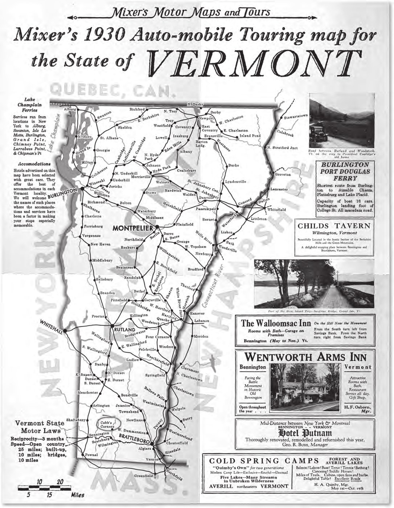

## Карта Вермонта

*Стилизованная дорожная карта 1930 года (картограф — Дин Энгелхардт). Коббс-Корнерс обведён кружком на юге штата, между Беннингтоном и Браттлборо, к северу от Уилмингтона. Надписи карты в переводе:*

- **Заголовок:** «Карты и маршруты Миксера для автомобилистов. Автомобильная туристическая карта штата Вермонт от Миксера, 1930». По краям — «Квебек, Канада», «Нью-Йорк», «Нью-Гэмпшир», «Массачусетс»; озеро Шамплейн, река Коннектикут.
- **Паромы озера Шамплейн:** паромы ходят из мест в штате Нью-Йорк в Олберг, Суонтон, Айл-Ла-Мотт, Берлингтон, Гранд-Айл, Чимни-Пойнт, Ларрабис-Пойнт и Чипманс-Пойнт.
- **Гостиницы:** гостиницы, которые рекламируются на этой карте, отобраны с большой тщательностью. Они предлагают лучшее жильё в каждом населённом пункте Вермонта. Будем рады, если вы сообщите нам о местах, где жильё и обслуживание сделали ваши остановки особенно запоминающимися.
- **Подписи к фотографиям:** «Дорога между Ратлендом и Вудстоком, Вт., по пути к старому дому президента Кулиджа»; «Часть маршрута по островам Херо — мост по песчаной косе, Гранд-Айл, Вт.».
- **Паром Берлингтон — Порт-Дуглас:** кратчайший путь из Берлингтона к ущелью Осейбл-Час, в Платтсбург и Лейк-Плэсид. Паром берёт 16 машин. Причал в Берлингтоне — у подножия Колледж-стрит. Вся дорога — щебёночная.
- **Таверна Чайлдса, Уилмингтон, Вермонт:** прекрасное место в живописной части Беркширских холмов и Зелёных гор. Чудесная остановка между Беннингтоном и Браттлборо.
- **Гостиница «Валлумсак»:** на холме у памятника. Номера с ванной, гараж при гостинице. Беннингтон (с мая по ноябрь), Вт. С юга — налево у сберегательного банка, с севера — направо у сберегательного банка.
- **Гостиница «Уэнтуорт Армс», Беннингтон, Вермонт:** напротив памятника битве в историческом Старом Беннингтоне. Открыта круглый год. Уютные номера с ванной, ресторан работает весь день, сувенирная лавка. Управляющий — Х. Ф. Осборн.
- **Отель «Патнэм», Беннингтон, Вермонт:** на полпути между Нью-Йорком и Монреалем. В этом году полностью отремонтирован, перестроен и заново обставлен. Управляющий — Джордж Р. Буш.
- **Лагерь «Колд-Спринг», Форест-Лейк и Эверилл-Лейкс:** «Владения Куимби» уже два поколения. Современная лагерная жизнь — избранное общество, покой, необычность. Пять озёр, множество ручьёв в нетронутой глуши. Лосось! Озёрная форель! Окунь! Форель! Теннис! Купание! Каноэ! Верховые лошади! Километры троп. Домики, камины и ванны. Отменный стол! Отличные дороги. Эверилл, северо-восточный Вермонт. Управляющий — Х. А. Куимби; с 1 мая по 15 октября.
- **Правила движения штата Вермонт:** взаимное признание прав — 3 месяца. Скорость: за городом — 40 км/ч; в населённых пунктах — 16 км/ч; на мостах — 16 км/ч.
- **Масштаб:** в милях (5, 10, 15, 20 миль — 8, 16, 24, 32 км).
