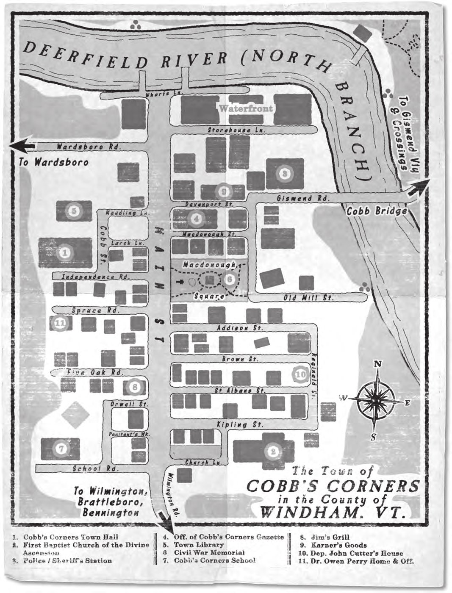

## Карта Коббс-Корнерс для Хранителя

*Надпись на карте: «Город Коббс-Корнерс, округ Уиндем, Вермонт». Картограф — Дин Энгелхардт.*

**Ключ карты:**

1. Ратуша Коббс-Корнерс
2. Первая баптистская церковь Божественного Вознесения
3. Полиция / контора шерифа
4. Редакция «Газетт Коббс-Корнерс»
5. Городская библиотека
6. Памятник Гражданской войны
7. Школа Коббс-Корнерс
8. Закусочная Джима
9. Лавка «Товары Карнеров»
10. Дом помощника шерифа Джона Каттера
11. Дом и приёмная доктора Оуэна Перри

**Прочие подписи:** река Дирфилд (северный рукав); пристани (Waterfront); мост Кобба (Cobb Bridge); площадь Макдоноу (Macdonough Square) с памятником; «К долине Гисменд и переправам» (To Gismend Vly & Crossings); «На Уордсборо» (To Wardsboro); «На Уилмингтон, Браттлборо, Беннингтон» (To Wilmington, Brattleboro, Bennington).

**Улицы:** Мейн-стрит (Главная улица, Main St.), Уорфс-лейн (Wharfs Ln.), Сторхаус-лейн (Storehouse Ln.), Уордсборо-роуд (Wardsboro Rd.), Гисменд-роуд (Gismend Rd.), Давенпорт-стрит (Davenport St.), Модлинг-лейн (Maudling Ln.), Кобб-стрит (Cobb St.), Ларч-лейн (Larch Ln.), Макдоноу-стрит (Macdonough St.), Индепенденс-роуд (Independence Rd.), Олд-Милл-стрит (Old Mill St.), Спрус-роуд (Spruce Rd.), Аддисон-стрит (Addison St.), Браун-стрит (Brown St.), Реджинальд-стрит (Reginald St.), Файв-Оук-роуд (Five Oak Rd.), Сент-Олбанс-стрит (St Albans St.), Оруэлл-стрит (Orwell St.), Киплинг-стрит (Kipling St.), Пенитентс-уок (Penitent’s Wk.), Чёрч-лейн (Church Ln.), Скул-роуд (School Rd.), Уилмингтон-роуд (Wilmington Rd.).
