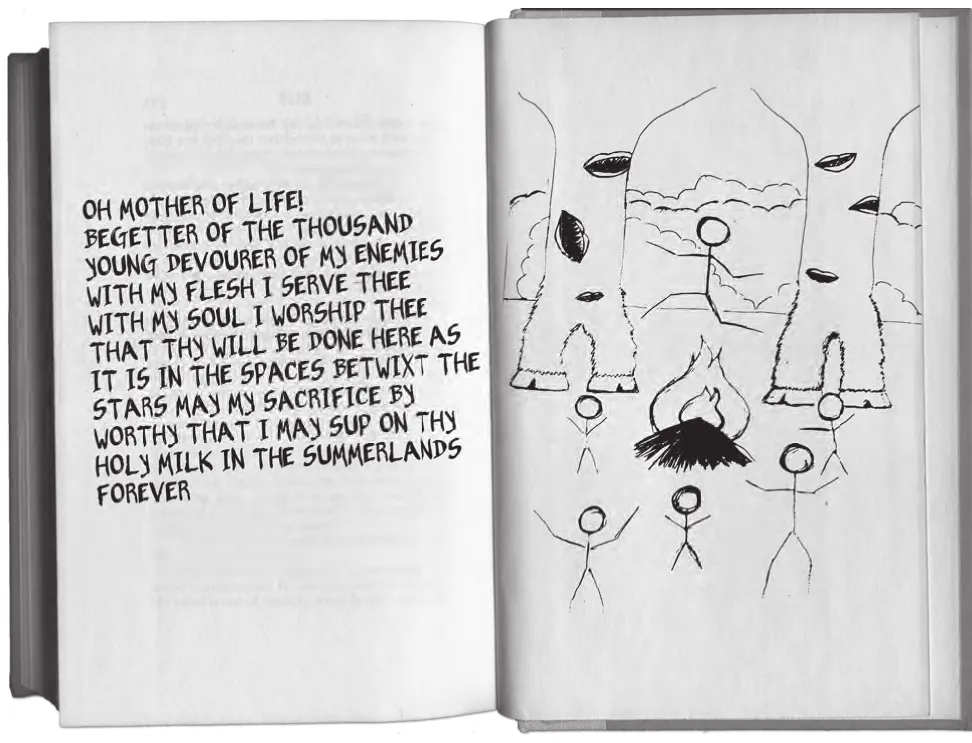

> **Раздатка «Жатва» 1**
>
> О МАТЬ ЖИЗНИ! 
> РОДИТЕЛЬНИЦА ТЫСЯЧИ 
> МЛАДЫХ, ПОЖИРАТЕЛЬНИЦА МОИХ ВРАГОВ, 
> ПЛОТЬЮ СВОЕЙ Я СЛУЖУ ТЕБЕ, 
> ДУШОЮ СВОЕЙ Я ПОКЛОНЯЮСЬ ТЕБЕ, 
> ДА БУДЕТ ВОЛЯ ТВОЯ ЗДЕСЬ, КАК 
> ОНА ЕСТЬ В ПРОСТРАНСТВАХ МЕЖДУ 
> ЗВЁЗДАМИ. ДА БУДЕТ ЖЕРТВА МОЯ 
> ДОСТОЙНА, ЧТОБЫ МНЕ ВКУШАТЬ ТВОЁ 
> СВЯТОЕ МОЛОКО В ЛЕТНИХ КРАЯХ 
> ВОВЕКИ
>
> *Рядом — грубый рисунок: дети и деревья пляшут вокруг костра.*

*Прим. перев.: в оригинале раздатки — «MAY MY SACRIFICE BY WORTHY» (вместо «BE WORTHY»); переведено по смыслу.*

**Сведения для своих:** Спенсера, старшего ребёнка в небольшой семье, вырастили баптистский священник и богобоязненная мать; кроме него в семье была только сестра Сара, на три года младше. Поскольку он был единственным сыном, родители возложили на мальчика почти все свои надежды, внимание и суровые убеждения. Взрослея, Спенсер толком не знал любви, зато знал, что «правильно», а что «неправильно». Это и побудило его в юные двадцать пять лет выставить свою кандидатуру на должность шерифа городка. Поскольку тогдашним шерифом все были недовольны, молодой Спенсер победил. С тех пор он удерживает свой пост благодаря непреклонному моральному кодексу. Разумеется, Младые никогда не предлагали Спенсеру вступить в культ. Джон Каттер напоминает Спенсеру его самого в том возрасте, поэтому шериф и сделал его своим помощником — и знать не знает, что Каттер — вожак культа Шуб-Ниггурат.

*Прим. перев.: в оригинале фамилия шерифа местами напечатана как «Spencer» вместо «Spenser».*

**В сюжете:** Спенсер не задумываясь посадит под замок любого из студентов, если заподозрит его в пьянстве, дурачестве и прочих мелких проступках. Шериф — самый последний человек, который поверит любым рассказам сыщиков о живущих в ближних холмах чудовищах-пришельцах. Порох и фитили могут пригодиться в эпизоде 5.

Характеристики шерифа Спенсера — в эпизоде 1.

## Редакция «Газетт Коббс-Корнерс»

«Газетт» — это контора и дом Ричарда Уэнделла, редактора, фотографа и единственного репортёра газеты. Здание двухэтажное: жилые комнаты наверху, контора — на первом этаже. Три больших окна выходят на Главную улицу, а к входной двери прибита латунная табличка: «„Газетт Коббс-Корнерс“, Ричард Уэнделл — главный редактор».

Уэнделл редко спит наверху в своей постели: он давно привык спать за письменным столом. Порядка в конторе нет: заметки, фотографии и статьи разбросаны по протёртому синему ковру, словно здесь была драка, а жёлтые оштукатуренные стены завешаны беспорядочными слоями карт и газетных страниц. В глубине — полностью оснащённая фотолаборатория и небольшой печатный станок, окружённый стопками чистой бумаги.

Большинство статей «Газетт» — обычная пища маленького городка: рождения, свадьбы, смерти, сводки с ферм, объявления, пересказы того, что говорят лодочники с реки Дирфилд, и разные религиозные брошюры. Всё это лишь гарнир к тем материалам, которые Уэнделл любит больше всего, — к большим статьям, где он печатает сплетни, слухи и намёки, от которых покраснели бы нынешние редакторы бульварных газет.
