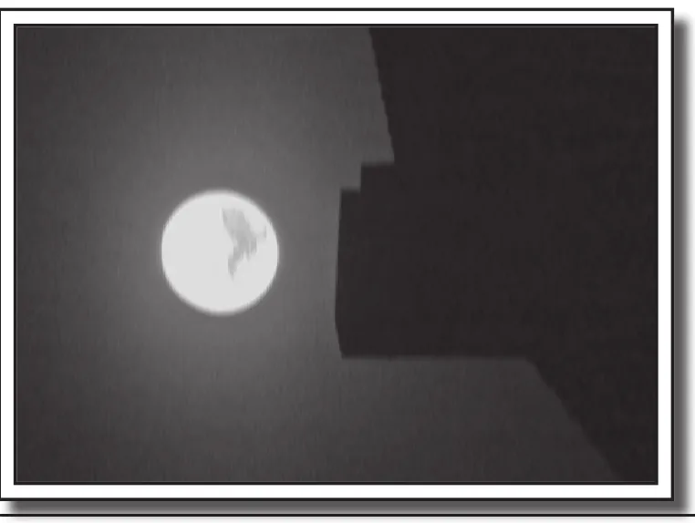

**Значение для кампании:** Уэнделл знакомится с сыщиками, когда они приезжают в Коббс-Корнерс, — см. «Поездка в закусочную Джима», с. 40, в эпизоде 1.

Уэнделл может помочь сыщикам несколькими способами. Во-первых, он может обратить их внимание на то, что в этих краях несоразмерно много молодых людей гибнет от несчастных случаев. Например, лет одиннадцать назад весь выпускной класс 1909 года (четверо юношей и две девушки) вскоре после окончания школы погиб разными смертями. Во-вторых, если Уэнделл решит, что сыщикам можно доверять, и если им удастся соблазнить его возможностью заполучить «по-настоящему большой материал», он вполне может рассказать им странную историю о том, что видел однажды ночью.

**Рассказ Уэнделла:** полгода назад Уэнделл испытывал новую эмульсию собственного изготовления, чтобы лучше фотографировать ночью. Прогуливаясь по городку, он услышал странный звук сверху. Подняв голову, он увидел в ночном небе что-то быстро летящее. Уэнделл говорит, что описать увиденное невозможно, — он лишь мельком это заметил, — но и того немногого, что он разглядел, хватило: это было нечто противоестественное, и его пробрала дрожь. Когда оно пролетало перед луной, он сфотографировал его, а потом бегом бросился домой и добрался совсем без сил. Он сунул фотоаппарат под стол и крепко уснул. Незадолго до рассвета его разбудил звук закрывающейся входной двери. Подняв голову, он увидел, что в окно на него смотрит помощник шерифа Каттер, а потом почувствовал запах гари — горела фотолаборатория! Он едва успел потушить пожар, прежде чем огонь распространился. Наутро Уэнделл пошёл в тюрьму и прямо заговорил с помощником шерифа Каттером о пожаре. Каттер ясно дал понять: «Мало того что у тебя нет никаких доказательств, — как думаешь, кому люди поверят? Все знают, что ты лжец и смутьян. Если я ещё раз услышу эту чушь, обещаю, тебе не понравится то, что с тобой случится».

Если сыщики спросят о снимке, который Уэнделл сделал той ночью, репортёр скажет, что плёнка оставалась в фотоаппарате и уцелела при пожаре. Позже он её проявил, но снимок вышел неудачным. Если сыщики захотят, он им его отдаст. Снимок (раздатка «Жатва» 2) очень зернистый и тёмный; на нём, кажется, виден размытый силуэт чего-то, летящего перед луной. Сама по себе фотография ничем не примечательна, но то, что она вообще существует, исключительно: ми-го обычно невозможно сфотографировать. Благодаря экспериментальной фотоэмульсии Уэнделла Грибов с Юггота теперь, по идее, можно запечатлеть на плёнке.

Это полезное знание может пригодиться сыщикам, когда они больше узнают о природе существ, обитающих в холмах. Записи о том, как изготовить эту эмульсию, всё ещё лежат где-то в хаотичной конторе Уэнделла: надо полагать, усердно поискав, сыщики смогут их найти и уговорить Уэнделла приготовить ещё эмульсии.

### Ричард Уэнделл, 35 лет, любопытный провинциальный репортёр

**Внешность и черты:** почти во всех отношениях средний — по росту, весу и чертам лица. Каштановые волосы и карие глаза. Из тех людей, чьё имя всегда забывают, чьё лицо никогда не запоминают и чьего присутствия часто не замечают.

**Общеизвестно:** горожане немногое могут сказать хорошего о своём местном асе-репортёре. У сыщиков складывается впечатление, что Уэнделл когда-нибудь да расстроил почти всех в Коббс-Корнерс; впрочем, это, похоже, не мешает им охотно платить за его особую разновидность «жёлтой журналистики».

**Сведения для своих:** Уэнделл никогда особенно не блистал — ни в школе, ни в обществе, ни в чём-либо ещё. Он отчаянно старается добиться большего, надеясь однажды раздобыть материал, достаточно громкий для какой-нибудь городской газеты. К сожалению, в маленьком городке мало что случается, а то, что случается, обычно замалчивают. Уэнделл позволяет себе некоторые вольности в своих статьях, пытаясь их приперчить и сделать интереснее, отчего он не пользуется любовью у соседей. Он заработал репутацию разгребателя грязи и лжеца.

> **Раздатка «Жатва» 2**
>
> *Фотография: тёмное ночное небо, яркий диск полной луны, на его фоне — размытый крылатый силуэт; справа — тёмный силуэт здания.*
