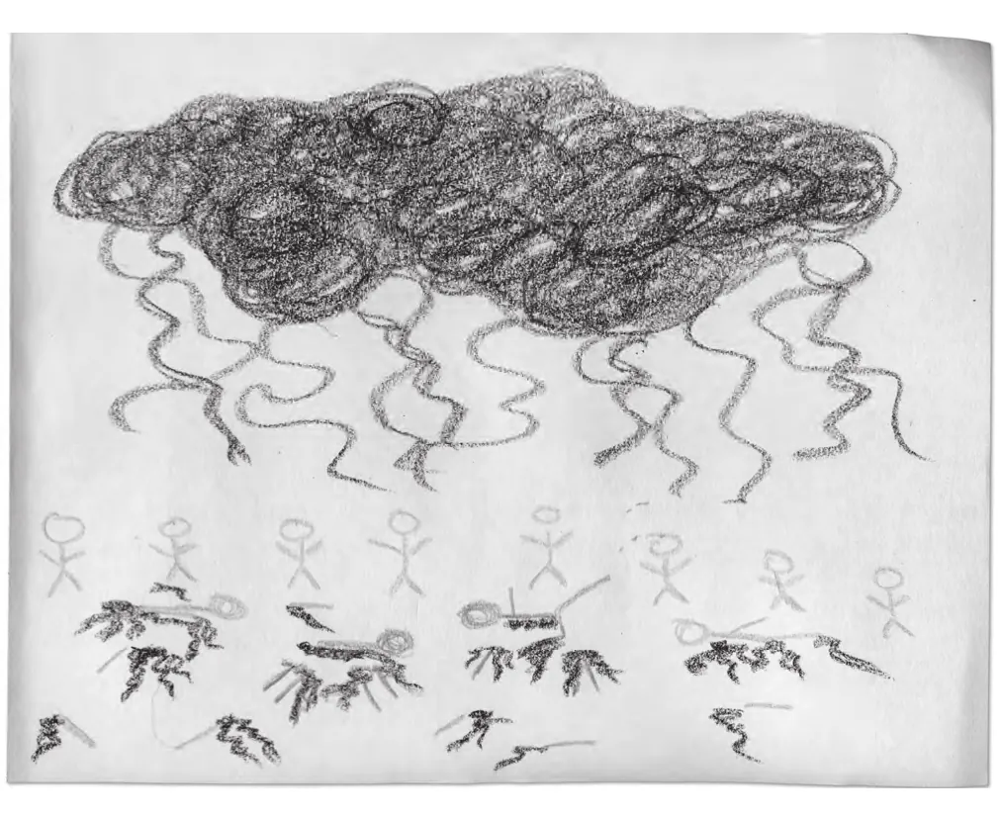

## Другие примечательные жители

### Агнус Беллуэзер, 88 лет, знаток местных преданий

**Внешность и черты:** маленькая, похожая на гнома женщина, но в её карих глазах ещё полно огня. Серебристые волосы до колен заплетены в одну толстую косу. Из-за близорукости носит очки без оправы, при ходьбе опирается на трость.

**Общеизвестно:** сыщики, которые станут расспрашивать, кто знает много странных историй, снова и снова будут слышать имя Агнус. Те, кто её любит, считают её мудрой женщиной, а те, кто не любит, — ведьмой.

**Сведения для своих:** Агнус была городской повитухой до того, как в Коббс-Корнерс приехал доктор Перри. Ремеслу она научилась у матери. Теперь она скромно зарабатывает на жизнь, готовя травяные снадобья и раздавая мудрые советы всякому, у кого найдётся лишняя монета или курица на обмен. Когда-то давно она была замужем, но муж умер от инфлюэнцы, прежде чем у них появились дети. Снова выйти замуж она так и не смогла себя заставить.

**В сюжете:** Агнус в любое время можно застать на крыльце — она дремлет или гладит свою кошку Белтейн. Она может помочь сыщикам, рассказав, что знает об истории городка.

```stat
СИЛ 30    ВЫН 50    ТЕЛ 35    ЛВК 45    ИНТ 75
НАР 50    МОЩ 70    ОБР 35    Рассудок 70   ПЗ 8
БкУ: –1   Комплекция: –1   Скорость: 3   ПМ: 15

Ближний бой (драка)   25% (12/5), урон 1d3–1
Уклонение             22% (11/4)

Навыки: Обаяние 60%, Средства 32%, Первая помощь 60%, Слух 55%, Тайные знания (местный фольклор) 60%, Медицина 50%, Естествознание 65%, Оккультизм 85%, Убеждение 40%, Психоанализ 45%, Психология 60%, Внимание 50%.
```

*Прим. перев.: так в оригинале — ПМ 15 при МОЩ 70 (по правилам 14).*

### Эмили Брейтуэйт, 18 лет, простодушная девушка

**Внешность и черты:** хорошенькая девушка с длинными рыжими волосами и веснушками на носу. Коленки в ссадинах от игр, ногти чёрные — она роется в земле, ловя жуков. С разумом трёхлетнего ребёнка, она очень доверчива.



> **Раздатка «Жатва» 3а**
>
> *Рисунок цветными карандашами: огромная чёрная туча из каракулей, из неё свисают волнистые щупальца; под тучей — ряд человечков-палочек; ниже — тёмные колючие крылатые существа с клешнями.*

*Подпись в книге: «Раздатка „Жатва“ 3а и 3б (на соседней странице)».*
