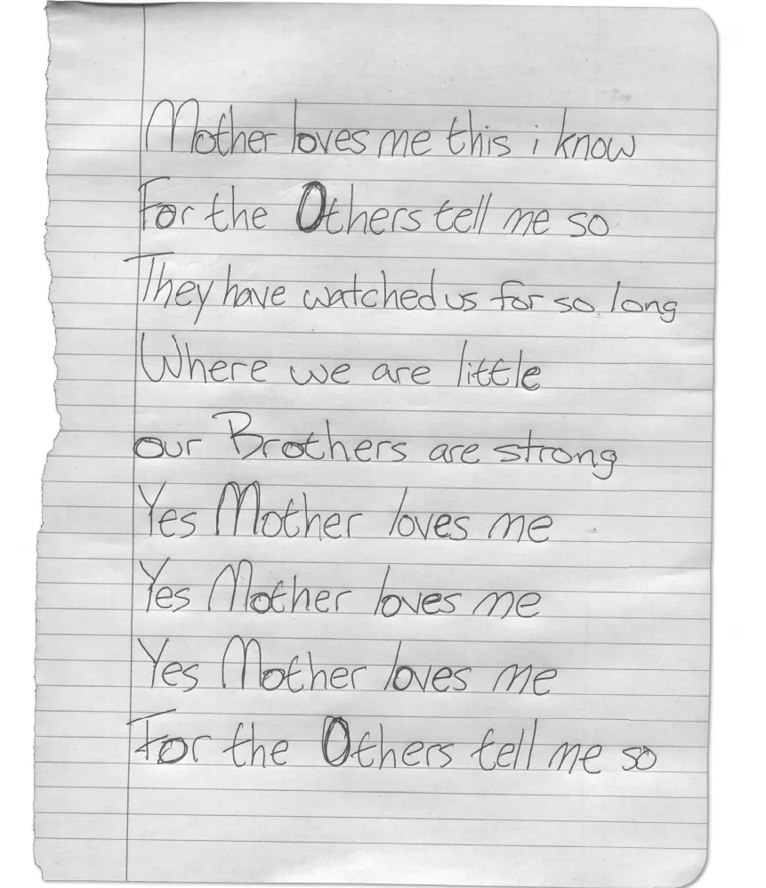

**Общеизвестно:** Эмили живёт с родителями на окраине городка, неподалёку от кленового леса. Большинство горожан знают, что ей трудно учиться.

**Сведения для своих:** Эмили тяжело появилась на свет, и в результате ей трудно учиться, к тому же она немая. Эмили ведёт себя как трёхлетний ребёнок: понимает простые указания, но, если за ней постоянно не присматривать, может уйти и потеряться.

**В сюжете:** сыщики могут услышать от горожан об исчезновении Эмили Брейтуэйт. Она пропала, пока мать развешивала бельё: Эмили увидела бабочку, пошла за ней в лес и заблудилась. Побродив, Эмили наткнулась на заброшенную лачугу и людей Ленга. Спасти её — дело сыщиков.

Характеристики Эмили Брейтуэйт — в эпизоде 1, с. 60.

### Джеймс «Джимми» Маклиран, 48 лет, озлобленный пьяница

**Внешность и черты:** типичный местный пьяница — большой, сильный и не слишком умный, который с равной вероятностью может ударить вас или поздороваться. У него грязные длинные каштановые волосы и глаза цвета речного ила. Обычно ходит в засаленных джинсах, заляпанной футболке и выцветшей бейсболке «Нью-Йорк Янкиз».

**Общеизвестно:** Джимми в городке знают все; говорят о нём в основном нехорошее.

**Сведения для своих:** Джимми известен пьянством, драками и тем, что он смутьян, каких поискать. Было время, когда Джимми держал себя в руках, — когда он был женат на Саре Спенсер, сестре шерифа. Никто не знает, зачем такая хорошенькая, добрая и умная молодая женщина, как Сара, вообще вышла замуж за такого никчёмного задиру. Но нет на свете ни мужчины, ни женщины, которые могли бы сказать, что эти двое не любили друг друга всем сердцем. Сара утихомирила буйного Джимми и сделала из него фермера и почтенного гражданина. Когда Сара умерла от чахотки (туберкулёза), Джимми обезумел от горя. Теперь он более чем слегка помешан и злее и гаже, чем когда-либо прежде.

**В сюжете:** Маклирану не нравится, что в его старом доме живут чужаки и тревожат покой Сары. Если он напьётся и разозлится как следует, он вполне может выкинуть что-нибудь отчаянное против «университетских», чтобы прогнать их от жены.

```stat
СИЛ 75    ВЫН 35    ТЕЛ 80    ЛВК 60    ИНТ 45
НАР 45    МОЩ 50    ОБР 40    Рассудок 15   ПЗ 11
БкУ: +1d4   Комплекция: 1   Скорость: 6   ПМ: 10

Ближний бой (драка)   70% (35/14), урон 1d3 + 1d4 или охотничий нож 1d6 + 1d4
Уклонение             40% (20/8)

Навыки: Искусство/ремесло (пить запоем) 85%, Лазание 65%, Средства 8%, Красноречие 50%, Прыжки 60%, Слух 60%, Естествознание 55%, Оккультизм 20%, Психология 30%, Внимание 60%, Скрытность 50%.
```



> **Раздатка «Жатва» 3б**
>
> Мать любит меня, я знаю,<br>
> Иные мне так говорят.<br>
> Они давно глядят на нас,<br>
> Где мы малы.<br>
> Наши братья сильны.<br>
> Да, Мать любит меня,<br>
> Да, Мать любит меня,<br>
> Да, Мать любит меня,<br>
> Иные мне так говорят.
>
> *Написано детским почерком на вырванном листе линованной бумаги.*
