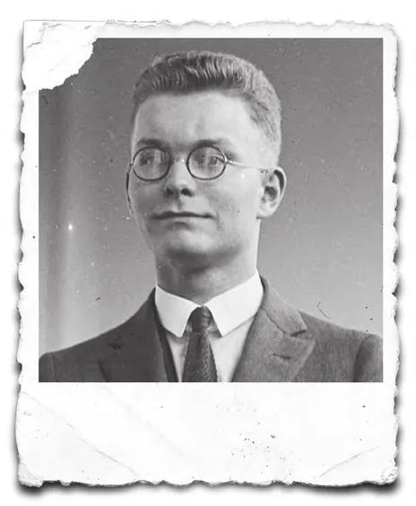

хоть раз-другой встречал Блейна в кампусе. Блейн умён, с язвительным чувством юмора и твёрдой целеустремлённостью. В последние месяцы он замкнулся и стал резче в обращении с людьми. Он больше не выступает за университетскую команду дебатов и за команду борцов, и его редко видят в прежних излюбленных местах. В кампусе всем известно, что когда-то у Блейна были серьёзные проблемы с выпивкой. Друзей у него теперь, похоже, немного.

**Тайное:** Блейн перешёл с естественных наук на антропологию, историю и фольклор. Утрата единственной любви — Дафны Девайн — повергла его в чёрное отчаяние, и он готов на всё, чтобы её вернуть.

**Сюжет:** Блейн — трагический злодей этой истории: довольно состоятельный и умный студент, которого утрата любимой, Дафны Девайн, довела до грани безумия (см. «Недавние события», с. 5, глава 1). Единственная его цель в жизни — воссоединиться с любимой женщиной, и ради мечты он охотно сделает всё, что велят ему ми-го. Для этого он сам отобрал Клариссу Тёрбер — чтобы та, сама того не ведая, дала новое тело мозгу Дафны Девайн.

### Кларисса Тёрбер, 21 год, студентка-химик

**Внешность и черты:** длинные светло-каштановые волосы, карие с зеленцой глаза, спортивная фигура. Чуть заметно шепелявит и старательно это скрывает. Любит красивые платья скромной длины. Из украшений носит только серебряный медальон (фамильную реликвию, доставшуюся от матери).

**Общеизвестно (проверка Знаний):** любой сыщик, которого интересуют естественные науки, скорее всего, встречал эту милую студентку-химика. В прочих кругах Тёрбер мало кто знает: она очень усердно учится. Известно, что сейчас она ни с кем не встречается, так что для желающих немного романтики она может оказаться заманчивой целью.

**Тайное:** отец Тёрбер за свою карьеру преподавал химию в трёх университетах; второе и самое памятное ему место — Мискатоник. Старый профессор направил двух своих сыновей в науку, но отпускать дочь в университет вовсе не собирался. Профессор Тёрбер твёрдо держался убеждений своего поколения: университет — не место для юной леди. В конце концов, после неотступных уговоров дочери и жены, профессор сдался, но с одним условием: Кларисса может учиться в Мискатоникском университете, но только на химическом и всегда должна попадать в список лучших студентов декана (как когда-то двое её старших братьев). Пока Кларисса учится в университете два года, и её средний балл — 3,8: лучше, чем у любого из братьев.

**Сюжет:** Блейн взял Клариссу в эту поездку с единственной целью — чтобы она дала тело отчуждённому мозгу Дафны Девайн. Поэтому он почти не спускает с неё глаз. Однако Кларисса — обычная юная девушка, и ей нравится внимание красивых мужчин. Если кто-то из сыщиков-мужчин начнёт с ней флиртовать, Блейн сделает всё, что в его силах, чтобы их разлучить (см. «Роман», с. 39).

### Джейсон Трент, 20 лет, студент-историк

**Внешность и черты:** тёмно-каштановые волосы и глаза, тонкие губы, круглое лицо. Одевается чопорно и держится так же скованно, как его накрахмаленные рубашки. Зрение у него настолько плохое, что без очков с толстыми стёклами он почти ничего не видит. Из-за застенчивости он говорит, только когда к нему обращаются, и, разговаривая, обычно отводит взгляд. С девушками его робость удваивается.

**Общеизвестно (проверка Знаний):** до университетской поездки никто из сыщиков не должен быть близким другом Трента. Кто-то, может, раз-другой видел, как он бродит по кампусу, но не более того. Хотя он учится в Мискатонике уже давно, он молчалив, застенчив и из тех людей, что будто растворяются на заднем плане. Друзей в университете у него мало, если они вообще есть, и он никогда не участвует в общественной жизни. Те, кто прекрасно знает жизнь кампуса, могут вспомнить, что у Трента репутация немного странного человека.

**Тайное:** Трент — единственный ребёнок властной вдовы, которая слишком его опекает. Отца он не знал. Единственная причина, по которой Трент едет в поездку с совершенно незнакомыми людьми, — увлёкшись собственными исследованиями, он запустил учёбу и теперь ему нужны дополнительные зачёты. Именно
