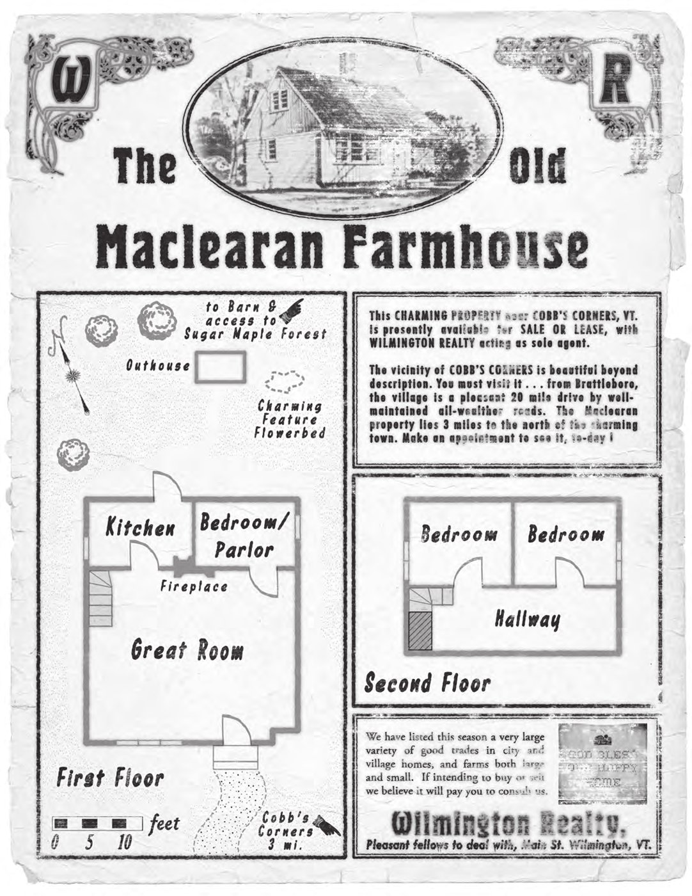

### План старого дома Маклиранов

Надписи на плане:

| Надпись | Перевод |
|---|---|
| The Old Maclearan Farmhouse | Старый дом Маклиранов |
| to Barn & access to Sugar Maple Forest | к амбару и выход в лес сахарных клёнов |
| Outhouse | уборная |
| Charming Feature Flowerbed | очаровательная клумба |
| Kitchen | кухня |
| Bedroom/Parlor | спальня/гостиная |
| Fireplace | камин |
| Great Room | большая комната |
| First Floor | первый этаж |
| Bedroom (×2) | спальня (две) |
| Hallway | коридор |
| Second Floor | второй этаж |
| 0 5 10 feet | масштаб: 0–1,5–3 м |
| Cobb’s Corners 3 mi. | Коббс-Корнерс — около 5 км |

Объявление на плане:

> Эта ОЧАРОВАТЕЛЬНАЯ УСАДЬБА близ КОББС-КОРНЕРС (штат Вермонт) сейчас ПРОДАЁТСЯ ИЛИ СДАЁТСЯ В АРЕНДУ; единственный агент — «УИЛМИНГТОН РИЭЛТИ».
>
> Окрестности КОББС-КОРНЕРС прекрасны — не описать словами. Вы непременно должны их увидеть... От Браттлборо до деревни — приятные 32 км пути по ухоженным всепогодным дорогам. Владение Маклиранов лежит в 5 км к северу от очаровательного городка. Договоритесь о просмотре — сегодня же!
>
> В этом сезоне у нас в продаже очень большой выбор выгодных предложений: дома в городах и деревнях, фермы большие и малые. Если вы собираетесь купить или продать — полагаем, вам выгодно обратиться к нам.
>
> [картинка: вышитая табличка «Боже, благослови наш счастливый дом»]
>
> **«Уилмингтон Риэлти».** С нами приятно иметь дело. Мейн-стрит, Уилмингтон, штат Вермонт.

*Подпись сбоку: «План дома Маклиранов. Художник — Дин Энгелхардт».*
