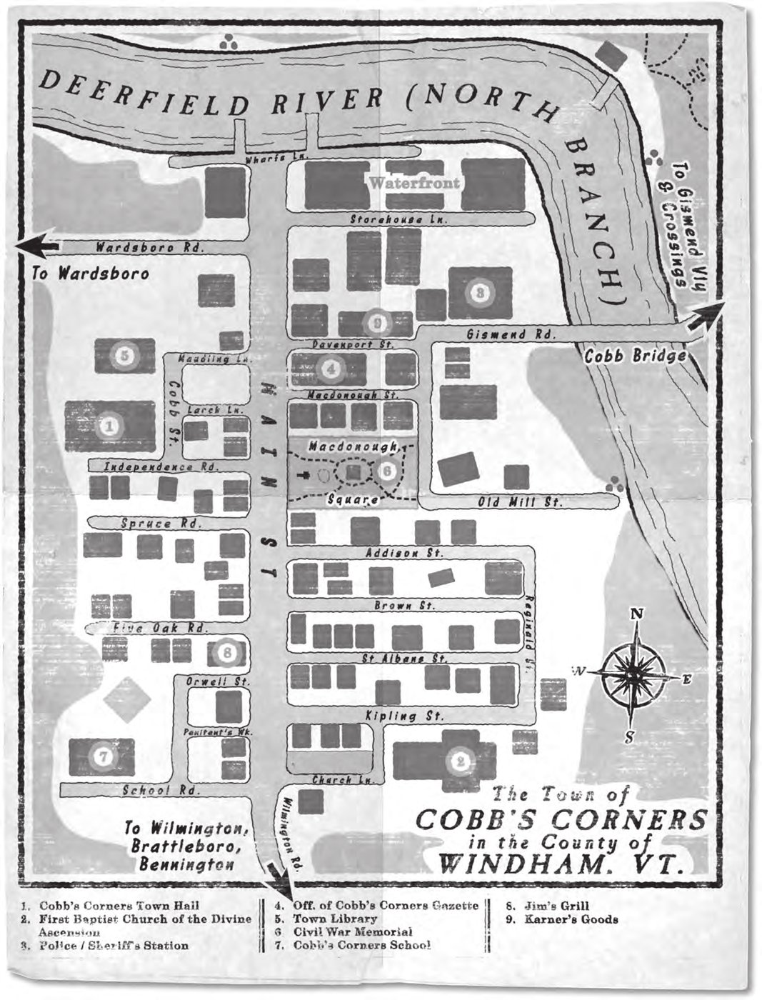

### Карта Коббс-Корнерс для игроков

Ключ карты:

| № | Надпись | Перевод |
|---|---|---|
| 1 | Cobb’s Corners Town Hall | Ратуша Коббс-Корнерс |
| 2 | First Baptist Church of the Divine Ascension | Первая баптистская церковь Божественного Вознесения |
| 3 | Police / Sheriff’s Station | Полиция / контора шерифа |
| 4 | Off. of Cobb’s Corners Gazette | Редакция «Газетт Коббс-Корнерс» |
| 5 | Town Library | Городская библиотека |
| 6 | Civil War Memorial | Памятник Гражданской войны |
| 7 | Cobb’s Corners School | Школа Коббс-Корнерс |
| 8 | Jim’s Grill | Закусочная Джима |
| 9 | Karner’s Goods | Лавка «Товары Карнеров» |

Прочие надписи:

| Надпись | Перевод |
|---|---|
| The Town of Cobb’s Corners in the County of Windham, VT. | Город Коббс-Корнерс, округ Уиндем, штат Вермонт |
| Deerfield River (North Branch) | река Дирфилд (северный рукав) |
| Waterfront | пристани |
| Cobb Bridge | мост Кобба |
| To Gismend Vly & Crossings | к долине Гисменд и переправам |
| To Wardsboro | на Уордсборо |
| To Wilmington, Brattleboro, Bennington | на Уилмингтон, Браттлборо, Беннингтон |
| Main St. | Мейн-стрит (главная улица) |
| Macdonough Square | площадь Макдоноу |
| Wharfs Ln., Storehouse Ln., Wardsboro Rd., Gismend Rd., Davenport St., Maudling Ln., Cobb St., Macdonough St., Larch Ln., Independence Rd., Old Mill St., Spruce Rd., Addison St., Brown St., Reginald St., Five Oak Rd., St Albans St., Orwell St., Kipling St., Penitent’s Wk., Church Ln., School Rd., Wilmington Rd. | Уорфс-лейн, Сторхаус-лейн, Уордсборо-роуд, Гисменд-роуд, Давенпорт-стрит, Модлинг-лейн, Кобб-стрит, Макдоноу-стрит, Ларч-лейн, Индепенденс-роуд, Олд-Милл-стрит, Спрус-роуд, Аддисон-стрит, Браун-стрит, Реджинальд-стрит, Файв-Оук-роуд, Сент-Олбанс-стрит, Оруэлл-стрит, Киплинг-стрит, Пенитентс-уок, Чёрч-лейн, Скул-роуд, Уилмингтон-роуд |
| N, S, E, W | С, Ю, В, З |

*Подпись сбоку: «Карта Коббс-Корнерс для игроков. Художник — Дин Энгелхардт».*
