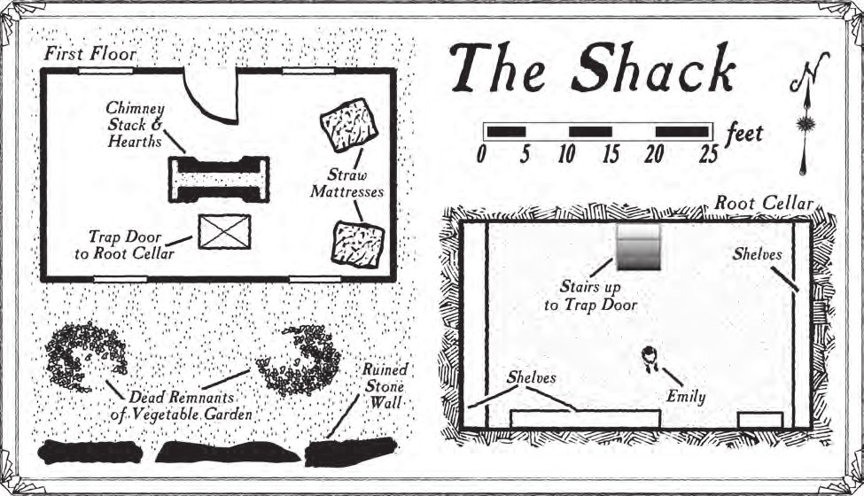

Надписи на плане:

| Надпись | Перевод |
|---|---|
| The Shack | Лачуга |
| First Floor | первый этаж |
| Chimney Stack & Hearths | печная труба и очаги |
| Straw Mattresses | соломенные тюфяки |
| Trap Door to Root Cellar | люк в погреб |
| Dead Remnants of Vegetable Garden | мёртвые остатки огорода |
| Ruined Stone Wall | разрушенная каменная стена |
| Root Cellar | погреб |
| Shelves (×2) | полки (двое) |
| Stairs up to Trap Door | лестница наверх к люку |
| Emily | Эмили |
| 0 5 10 15 20 25 feet | масштаб: 0–25 футов (0–8 м) |

Ленгиты подвесили Эмили на верёвке, привязанной к одной из деревянных балок погреба. Она висит, а люди Ленга хлещут её кожаным ремнём или тычут в неё копьями. Голые, если не считать грязных штанов, с маленькими рожками, торчащими изо лба, и заскорузлыми от грязи копытами, выглядывающими из-под рваных штанин, они в точности похожи на сбежавших из ада демонов — потребуйте проверку Рассудка (потеря 0/1d4).

Засада с превосходящим оружием, скорее всего, быстро расправится с людьми Ленга. Если половина из них убита или выведена из строя, уцелевшие пытаются бежать к своему хозяину — лунному зверю, а если они на первом этаже — сбегают обратно в погреб и баррикадируются там (чтобы вломиться в погреб, нужна проверка СИЛ), и спасти Эмили становится немного труднее.

Если Эмили спасут, после того как её срежут с верёвки, она оседает на пол, едва живая от страшных ран, которые ей нанесли. После успешной проверки Первой помощи она может идти, хоть и с трудом, но подняться по лестнице ей нужно помочь. Если сыщики сумеют вернуться в город, родители Эмили, конечно, будут благодарны за её возвращение и захотят расспросить сыщиков, где её нашли и что с ней случилось. У шерифа вопросы будут посерьёзнее — а то и обвинения, — так что сыщикам, возможно, лучше оставить Эмили там, где её быстро найдут, и не впутываться в потенциально неприятную историю. Эмили немая и из-за пережитой травмы и потрясения, конечно, не сможет опознать сыщиков, если её снова сведут с ними.

Если ленгитам как-то удалось сбежать, они прячутся в лесу и пытаются соединиться с лунным зверем (если он ещё жив). В конце концов эти создания кошмара выходят творить новые бесчинства — пока их не убьют или пока сыщики не отправят их обратно в Страну грёз, отключив Врата сна, когда убьют то, что осталось от Джеффри.

### Эмили Брейтуэйт, 18 лет, простодушная девушка

**Внешность и черты:** хорошенькая девушка с длинными рыжими волосами и веснушками на носу. Коленки у неё в болячках от игр, ногти черны оттого, что она роется в земле, ловя жуков. С разумом трёхлетнего ребёнка она очень доверчива.

**Общеизвестно:** Эмили живёт с родителями на окраине города, недалеко от кленового леса. Большинство горожан знает, что она отстаёт в развитии.

**Сюжет:** сыщики могут услышать об исчезновении Эмили Брейтуэйт от горожан. Она пропала, пока мать развешивала бельё: Эмили увидела бабочку, пошла за ней в лес и заблудилась. Побродив, Эмили наткнулась на заброшенную лачугу и людей Ленга. Спасти её — дело сыщиков.

Характеристики Эмили Брейтуэйт — в **приложении A. Персонажи и чудовища**, с. 58.

## Необязательная концовка: Врата сна

Если на четвёртый день сыщики занимались интерлюдией с Вратами сна, то, когда ми-го наносят удар, их нет на месте. Вернувшись, сыщики находят дом пустым, хотя видны следы борьбы. Ночь проходит без происшествий, а утром возвращаются Блейн и студенты, которым уже подменили мозги. Агенты ми-го теперь странно молчаливы и холодны со сыщиками. Успешные
