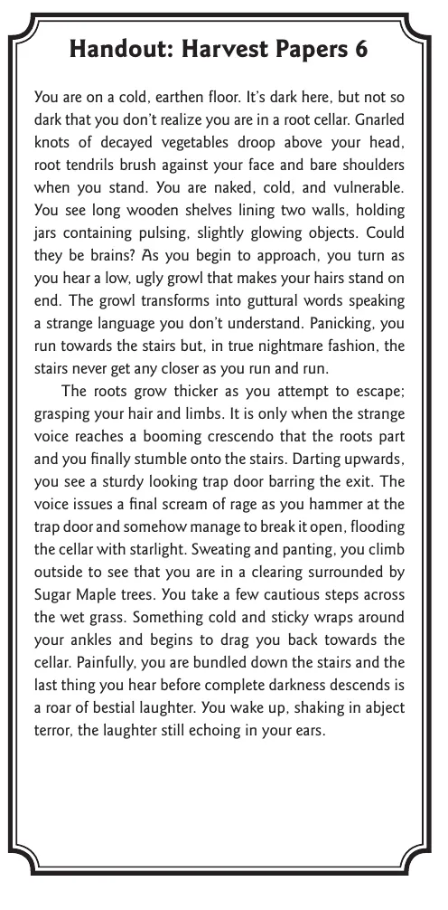
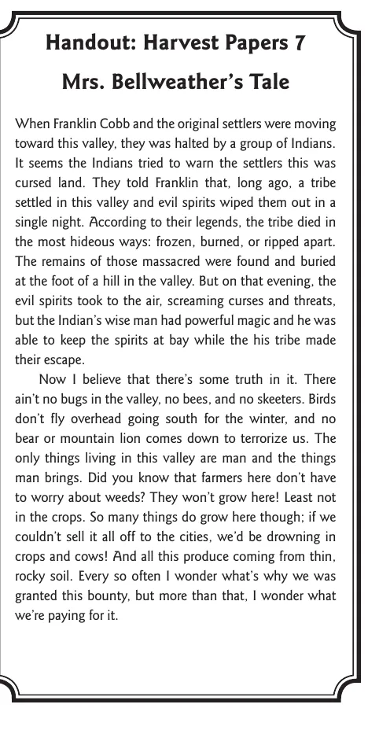

> **Раздатка «Жатва» 6: сон о погребе** — перевод на с. 50.

> **Раздатка «Жатва» 7: рассказ миссис Беллуэзер** — перевод на с. 51.

*Прим. перев.: в этой копии раздатки в последней фразе напечатано «I wonder what’s why we was granted»; на с. 51 — «I wonder why we was granted» («за что нам дано»); перевод — по с. 51.*
