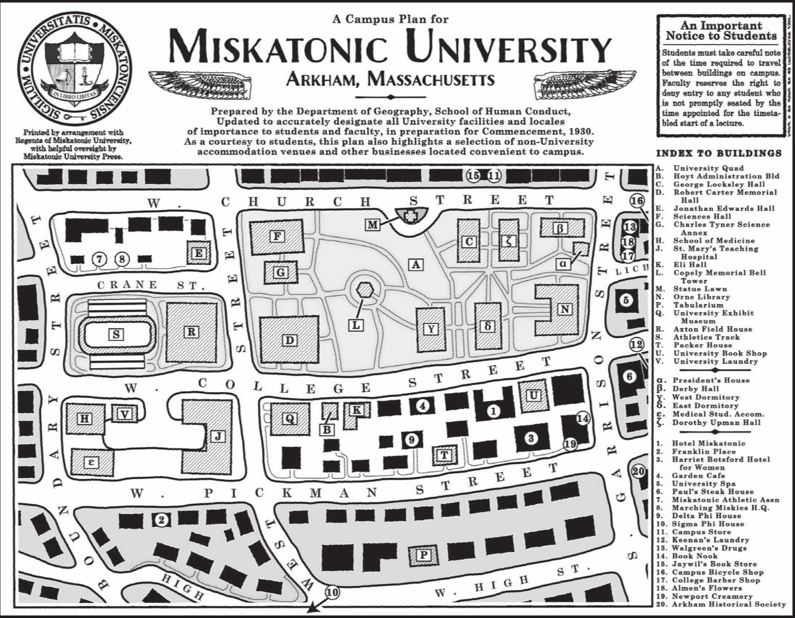

## Карта Мискатоникского университета

*Надписи карты в переводе:*

**План кампуса Мискатоникского университета. Аркхэм, Массачусетс.** Подготовлен кафедрой географии Школы человеческого поведения. Обновлён, чтобы точно обозначить все учреждения университета и места, важные для студентов и преподавателей, к выпускной церемонии 1930 года. В помощь студентам на плане отмечены также некоторые неуниверситетские жилые дома и другие заведения, удобно расположенные рядом с кампусом. *Напечатано по договорённости с попечителями Мискатоникского университета, под благосклонным надзором издательства Мискатоникского университета.* На печати — «Sigillum Universitatis Miskatonicensis», девиз «In libro libertas».

> **Важное объявление для студентов**
>
> Студентам следует внимательно учитывать время, нужное на переходы между зданиями кампуса. Преподаватель оставляет за собой право не впустить студента, не занявшего своё место к началу лекции по расписанию.

**Указатель зданий**

| Знак | Здание |
|---|---|
| A | Главный двор Мискатоника (University Quad) |
| B | Административный корпус Хойта |
| C | Джордж-Локсли-холл |
| D | Мемориальный корпус Роберта Картера |
| E | Джонатан-Эдвардс-холл |
| F | Научный корпус |
| G | Научный флигель Чарльза Тайнера |
| H | Медицинская школа |
| J | Клиническая больница св. Марии |
| K | Илай-холл |
| L | Мемориальная колокольня Копли |
| M | Лужайка со статуей |
| N | Библиотека Орна |
| P | Табулариум |
| Q | Музей Мискатоникского университета |
| R | Спортивный комплекс Акстона |
| S | Легкоатлетический стадион |
| T | Пэкер-хаус |
| U | Университетский книжный магазин |
| V | Университетская прачечная |
| α | Дом президента университета |
| β | Дерби-холл |
| γ | Западное общежитие |
| δ | Восточное общежитие |
| ε | Общежитие студентов-медиков |
| ζ | Общежитие имени Дороти Апмен |
| 1 | Отель «Мискатоник» |
| 2 | Пансион «Франклин-плейс» |
| 3 | Женская гостиница Гарриет Ботсфорд |
| 4 | Кафе «Гарден» |
| 5 | Закусочная «Юниверсити спа» |
| 6 | Стейк-хаус Пола |
| 7 | Мискатоникская атлетическая ассоциация |
| 8 | Штаб «Марширующих Мисков» |
| 9 | Дом братства Дельта Фи |
| 10 | Дом братства Сигма Фи |
| 11 | Магазин «Кампус» |
| 12 | Прачечная Кинана |
| 13 | Аптека «Уолгринс» |
| 14 | Книжная лавка «Бук-Нук» |
| 15 | Книжный магазин Джейвила |
| 16 | Велосипедный магазин «Кампус» |
| 17 | Парикмахерская «Колледж» |
| 18 | Цветы Олмена |
| 19 | Кафе-мороженое «Ньюпорт» |
| 20 | Аркхэмское историческое общество |

Улицы на карте: Уэст-Чёрч-стрит, Крейн-стрит, Уэст-Колледж-стрит, Уэст-Пикман-стрит, Уэст-Хай-стрит.

*Прим. перев.: на карте опечатки — «Copely» (Копли), «Miskatonic Universaity» в вертикальной надписи.*
