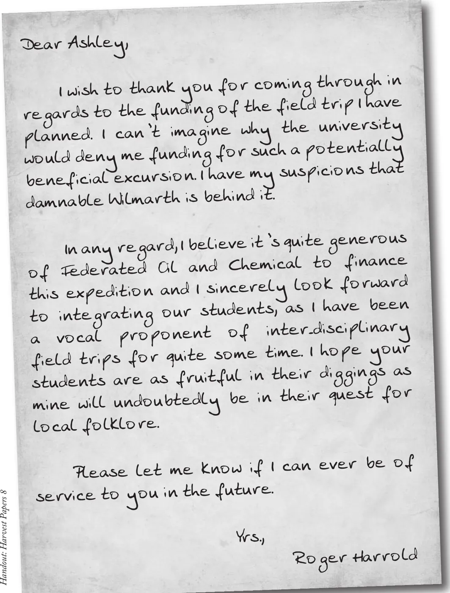

> **Раздатка «Жатва» 8**
>
> *Рукописная записка*
>
> Дорогой Эшли,
>
> Хочу поблагодарить вас за то, что выручили меня с финансированием задуманной мною экспедиции. Не могу представить, почему университет отказал мне в деньгах на столь полезную поездку. Подозреваю, что за этим стоит этот проклятый Уилмарт.
>
> Как бы то ни было, я считаю, что со стороны «Федерейтед Ойл энд Кемикал» весьма щедро оплатить эту экспедицию, и искренне жду возможности объединить наших студентов: я давно и открыто выступаю за междисциплинарные полевые поездки. Надеюсь, ваши студенты будут так же удачливы в своих раскопках, как мои, несомненно, — в поисках местного фольклора.
>
> Дайте знать, если я когда-нибудь смогу быть вам полезен.
>
> Ваш
>
> *Роджер Харролд*
