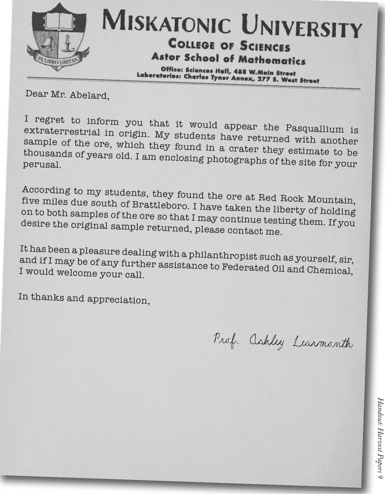

> **Раздатка «Жатва» 9**
>
> *Машинописное письмо на бланке*
>
> **Мискатоникский университет** 
> **Колледж наук** 
> **Математическая школа Астора** 
> Кабинет: Научный корпус, Уэст-Мейн-стрит, 488 
> Лаборатории: флигель Чарльза Тайнера, Саут-Уэст-стрит, 277
>
> Уважаемый мистер Абелард,
>
> С сожалением сообщаю вам, что паскуаллий, по-видимому, внеземного происхождения. Мои студенты вернулись с ещё одним образцом руды, который они нашли в кратере, чей возраст они оценивают в тысячи лет. Прилагаю фотографии места для вашего ознакомления.
>
> По словам моих студентов, руду они нашли у горы Ред-Рок, в восьми километрах строго к югу от Браттлборо. Я взял на себя смелость оставить у себя оба образца руды, чтобы продолжить испытания. Если вы желаете получить первый образец обратно, пожалуйста, свяжитесь со мной.
>
> Было приятно иметь дело с таким филантропом, как вы, сэр, и если я смогу ещё чем-нибудь помочь «Федерейтед Ойл энд Кемикал», буду рад вашему звонку.
>
> С благодарностью и признательностью,
>
> *проф. Эшли Лирмонт*
