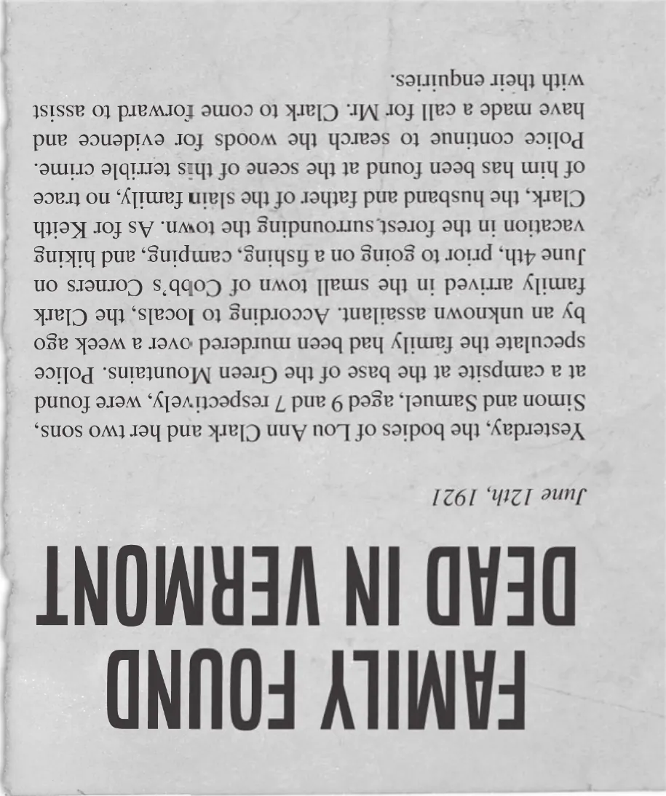

> **Раздатка «Жатва» 10**
>
> *Газетная вырезка*
>
> **СЕМЬЯ НАЙДЕНА МЁРТВОЙ В ВЕРМОНТЕ**
>
> *12 июня 1921 года*
>
> Вчера на стоянке у подножия Зелёных гор нашли тела Лу Энн Кларк и двух её сыновей, Саймона и Сэмюэла, девяти и семи лет. Полиция полагает, что семью убил неизвестный больше недели назад. По словам местных жителей, семья Кларков приехала в городок Коббс-Корнерс 4 июня, чтобы порыбачить, пожить в палатках и походить по окрестным лесам. Что до Кита Кларка, мужа и отца погибшей семьи, на месте этого страшного преступления его следов не найдено. Полиция продолжает искать улики в лесу и призывает мистера Кларка явиться и помочь следствию.

## Поиски Блейна

После того, что случилось с ними в вермонтской поездке, сыщики, скорее всего, уже очень подозревают Роберта Блейна. Однако с тех пор, как все вернулись, отсутствие Блейна бросается в глаза. Если сыщики станут его искать, они его не найдут — где бы и сколько бы ни искали. Он словно исчез.

Если сыщики потрудятся порасспрашивать о Блейне по кампусу, они быстро узнают, что он снова начал сильно пить, а также пропускает занятия и избегает старых друзей. Сыщики могут захотеть наведаться к Блейну домой. Пройдя проверку Обаяния, Красноречия или Убеждения, чтобы уговорить кого-то из старых друзей Блейна дать его адрес, или добравшись до студенческих личных дел (возможно, с помощью успешной проверки социального навыка или Скрытности), сыщики узнают, что он живёт в переделанной мансарде дома за пределами кампуса на Уэст-Пикман-стрит.

В доме хозяин, Сэм Флэнаган, без веской причины не пускает в комнату Блейна (проверка Обаяния, Красноречия, Запугивания или Убеждения). Если спросить, он говорит, что не видел Блейна несколько дней. Пробраться внутрь можно и незаконно, дождавшись, пока пожилой хозяин — единственный жилец дома под мансардой — уйдёт. Незапертое окно кухни (его легко найти, если поискать) или успешная проверка Взлома на замке задней двери открывают путь в дом. Сыщикам, вламывающимся в дом, следует также пройти проверку Скрытности, чтобы их не заметили соседи или прохожие и не вызвали полицию.

На первый взгляд в однокомнатной квартире Блейна нет ничего по-настоящему ценного для сыщиков. Видно, что комнату содержали в довольно хорошем порядке и чистоте, но теперь повсюду разбросаны книги и учебные записи, а также множество пустых бутылок из-под виски. Успешная проверка Психологии подсказывает, что жильца недавно что-то сильно потрясло и он ищет утешения в бутылке.

Тщательный обыск комнаты показывает, что на нескольких книжных полках стоит полный комплект энциклопедий и несколько книг геологического толка. Рядом с этими зачитанными книгами — пара книг по антропологии и американскому фольклору, которые, похоже, едва открывали, не то что читали. Под грудой грязной одежды в шкафу — ещё пустые бутылки из-под виски. У кровати, на подержанной тумбочке, — небольшая стопка книг об оккультизме, в том числе «Разоблачённая Изида» Е. П. Блаватской (+6 Оккультизма), «Открытие колдовства» Реджинальда Скота (+6 Оккультизма) и «О демониальности» Лодовико Марии Синистрари (+3 Оккультизма). Полное прочтение этих книг даёт несколько пунктов навыка Оккультизм (в скобках), но почти ничего важного для дела. При обыске стола Блейна находится любопытное письмо (раздатка «Жатва» 8), которое может повести к дальнейшему расследованию, когда сыщики вернутся в Коббс-Корнерс (как описано в эпизоде 4).

*Прим. перев.: в оригинале здесь письмо из стола названо раздаткой 8, а записка из дневника (ниже) — раздаткой 9; по содержанию и по с. 19–20 это раздатки 11 (письмо Эмельды Кратчетт) и 12 (записка Харролда Дафне Девайн). Автор «Demonality» напечатан как «Sinistari» — правильно Синистрари (Sinistrari).*

Успешная проверка Внимания позволяет заметить на полу и на столе Блейна мелкие пёрышки (пух). Если перевернуть матрас, обнаружится разрез, в котором спрятан рукописный дневник, когда-то принадлежавший Дафне Девайн. Когда дневник открывают, из него выпадает отдельный листок — короткая записка профессора Харролда (раздатка «Жатва» 9).

Чтение спрятанной книги показывает, что Девайн сдала свой дневник профессору Харролду в надежде, что её с товарищами снова отправят в Коббс-Корнерс, чтобы собрать больше данных и, возможно, вещественные доказательства существования странных созданий, будто бы живущих в горах. Дневник начинается с перечня успехов, достигнутых группой к тому времени, и объясняет, что окрестности Коббс-Корнерс изобилуют местными легендами. Затем Девайн подробно излагает свои планы снова расспросить местного жителя по имени Джетро Кратчетт в надежде получить дневники его деда: в них — множество народных сказаний, собранных дедом, когда тот был коммивояжёром. Наконец, бо́льшая часть дневника — местные легенды, которые группе удалось собрать.
