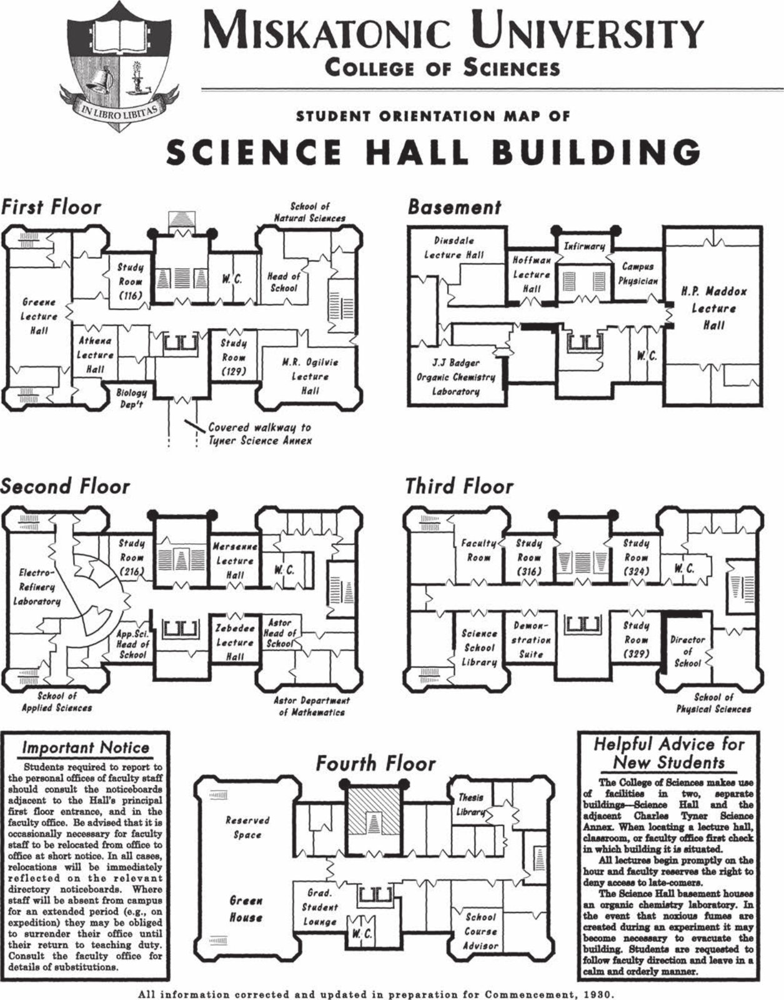

## План Научного корпуса М. У.

*Надписи плана в переводе:*

**Мискатоникский университет. Колледж наук. Ознакомительный план Научного корпуса для студентов.**

| Этаж | Помещения |
|---|---|
| Первый этаж | Школа естественных наук; учебная комната 116; уборная; кабинет главы школы; лекционный зал Грина; лекционный зал «Афина»; учебная комната 129; лекционный зал М. Р. Огилви; кафедра биологии; крытый переход в Научный флигель Тайнера |
| Подвал | лекционный зал Динсдейла; лекционный зал Хоффмана; лазарет; врач кампуса; лекционный зал Х. П. Мэддокса; лаборатория органической химии Дж. Дж. Баджера; уборная |
| Второй этаж | электрорафинировочная лаборатория; учебная комната 216; лекционный зал Мерсенна; уборная; кабинет главы Школы прикладных наук; лекционный зал Зеведея; кабинет главы Математического отделения Астора; Школа прикладных наук; Математическое отделение Астора |
| Третий этаж | преподавательская; учебные комнаты 316, 324 и 329; уборная; библиотека Научной школы; демонстрационный зал; кабинет директора школы; Школа физических наук |
| Четвёртый этаж | резервное помещение; оранжерея; гостиная аспирантов; уборная; библиотека диссертаций; куратор курсов школы |

> **Важное объявление**
>
> Студентам, которым велено явиться в личный кабинет кого-либо из преподавателей, следует свериться с досками объявлений у главного входа корпуса на первом этаже и в преподавательской. Имейте в виду: иногда преподавателей приходится переводить из кабинета в кабинет без долгого предупреждения. Во всех случаях переезды немедленно отражаются на соответствующих досках-указателях. Если преподаватель надолго отлучается из кампуса (например, в экспедицию), он может быть обязан освободить кабинет до возвращения к преподаванию. Сведения о замещениях — в преподавательской.

<!-- -->

> **Полезный совет новым студентам**
>
> Колледж наук занимает два отдельных здания — Научный корпус и соседний Научный флигель Чарльза Тайнера. Ища лекционный зал, учебную комнату или кабинет преподавателя, сначала проверьте, в каком здании он находится.
>
> Все лекции начинаются точно в начале часа, и преподаватель вправе не впустить опоздавших.
>
> В подвале Научного корпуса находится лаборатория органической химии. Если во время опыта образуются ядовитые пары, может понадобиться эвакуировать здание. Студентов просят следовать указаниям преподавателей и выходить спокойно и организованно.

*Внизу плана:* «Все сведения исправлены и обновлены к выпускной церемонии 1930 года».
