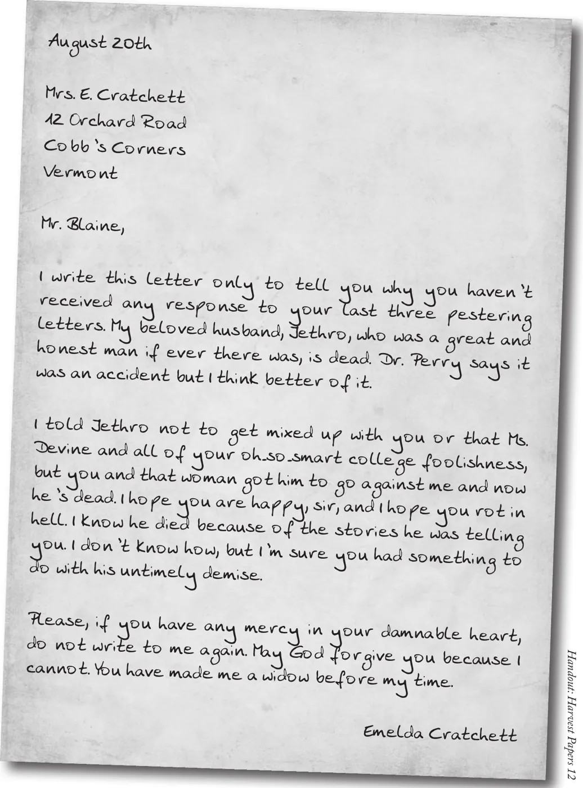

> **Раздатка «Жатва» 11**
>
> *Рукописное письмо*
>
> 20 августа
>
> Миссис Э. Кратчетт 
> Орчард-роуд, 12 
> Коббс-Корнерс 
> Вермонт
>
> Мистер Блейн,
>
> Пишу это письмо только затем, чтобы объяснить, почему вы не получили ответа на три ваших последних назойливых письма. Мой любимый муж Джетро, честнейший и прекраснейший человек на свете, умер. Доктор Перри говорит, что это несчастный случай, но я думаю иначе.
>
> Я говорила Джетро не связываться ни с вами, ни с этой мисс Девайн, ни со всей вашей учёной университетской дурью, но вы с той женщиной настроили его против меня, и теперь он мёртв. Надеюсь, вы довольны, сэр, и надеюсь, вы сгниёте в аду. Я знаю, что он умер из-за историй, которые вам рассказывал. Не знаю как, но уверена, что вы приложили руку к его безвременной кончине.
>
> Прошу вас, если в вашем проклятом сердце есть хоть капля жалости, больше мне не пишите. Да простит вас Бог, потому что я не могу. Вы сделали меня вдовой до срока.
>
> *Эмельда Кратчетт*
