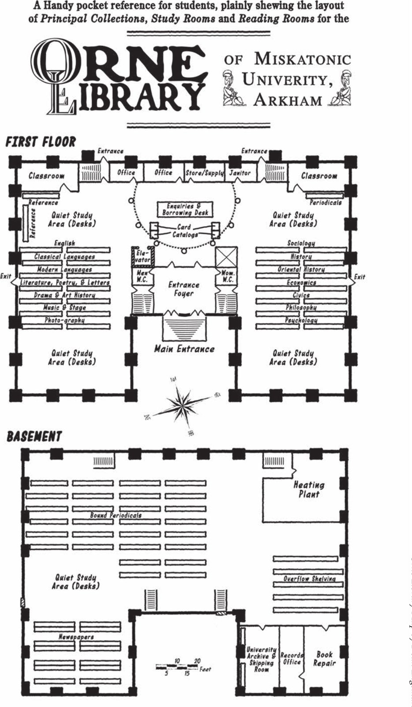

## План библиотеки Орна

*Надписи плана в переводе:*

**Удобный карманный справочник для студентов, наглядно показывающий расположение главных собраний, учебных комнат и читальных залов библиотеки Орна Мискатоникского университета, Аркхэм.**

| Этаж | Помещения |
|---|---|
| Первый этаж | главный вход; вестибюль; два входа (северо-западный и северо-восточный) и два выхода (западный и восточный); аудитории (2); кабинеты (2); кладовая; комната уборщика; справочный фонд; периодика; справочный стол и абонемент; карточные каталоги; тихие читальные залы (столы); английский язык; классические языки; новые языки; литература, поэзия и письма; драма и история искусства; музыка и сцена; фотография; социология; история; история Востока; экономика; обществоведение; философия; психология; лифт; мужская и женская уборные |
| Подвал | котельная; переплетённые подшивки периодики; тихий читальный зал (столы); дополнительные стеллажи; газеты; университетский архив и экспедиция; отдел учёта; переплётная (ремонт книг) |
