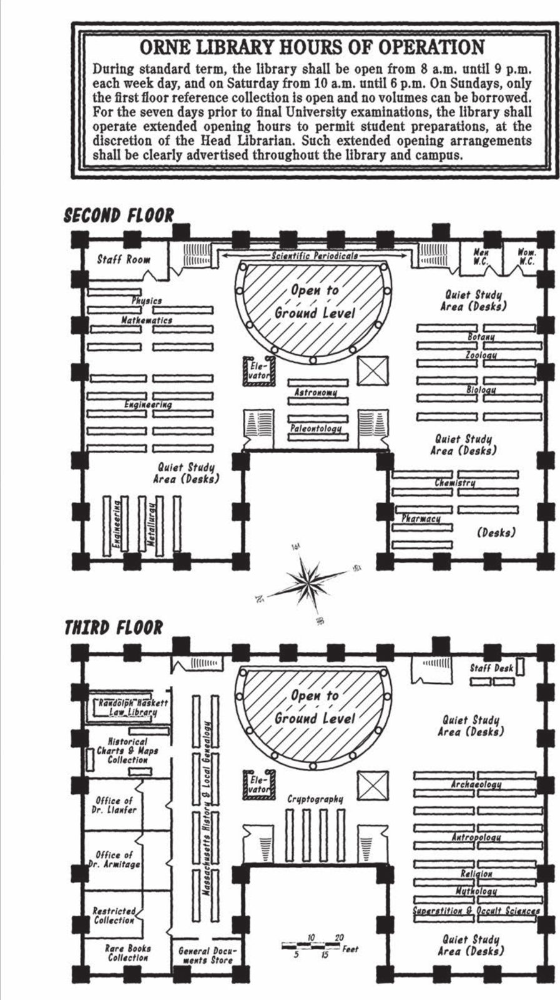

## План библиотеки Орна, верхние этажи

*Надписи плана в переводе:*

> **Часы работы библиотеки Орна**
>
> Во время обычного семестра библиотека открыта по будним дням с 8:00 до 21:00, по субботам — с 10:00 до 18:00. По воскресеньям открыт только справочный фонд первого этажа, и книги на дом не выдаются. В течение семи дней перед выпускными экзаменами университета библиотека работает по удлинённому расписанию, чтобы студенты могли подготовиться, — на усмотрение главного библиотекаря. О таком удлинённом расписании будет ясно объявлено по всей библиотеке и кампусу.

| Этаж | Помещения |
|---|---|
| Второй этаж | комната сотрудников; научная периодика; мужская и женская уборные; проём до первого этажа; тихие читальные залы (столы); физика; математика; ботаника; зоология; лифт; биология; астрономия; инженерное дело; палеонтология; химия; металлургия; фармакология; столы |
| Третий этаж | стол сотрудника; юридическая библиотека Рэндольфа Хаскетта; проём до первого этажа; тихие читальные залы (столы); история Массачусетса и местная генеалогия; собрание исторических карт и планов; лифт; криптография; археология; кабинет доктора Лланфера; антропология; кабинет доктора Армитеджа; религия; мифология; суеверия и оккультные науки; Закрытое собрание; собрание редких книг; хранилище общих документов |

*Прим. перев.: на плане опечатка «Antropology» (антропология).*
